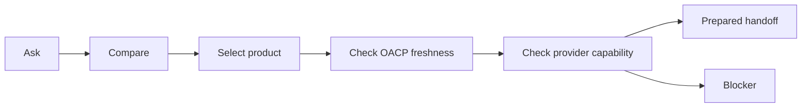

<Note>
Update, 20 October 2026. Since this post, Grantex signs every OACP artifact (ES256), keeps a revocable status list entry for each, issues Intent, Cart and Payment mandates, and countersigns AgenticOrg's purchase decisions. AgenticOrg's checkout and payment execution are separate and behind its own switches, which default to off; with them off, a purchase request still ends in a prepared handoff or a blocker as described here. Current status: [OACP runtime launch closure PRD](/guides/oacp/runtime-launch-closure-prd).
</Note>

## Summary

OACP supports a safe buyer journey: ask, compare, select, check freshness, verify provider capability, then prepare a handoff or refuse.

## Target Audience

Buyer-experience designers, channel teams, and operators.

## Architecture Diagram

## End-To-End Flow

The buyer asks a product question. AgenticOrg answers from cache with source labels. The buyer asks to buy. AgenticOrg checks catalog, price, inventory, policy, mandate capability, protocol adapter, and freshness records. It returns a prepared handoff if allowed or a clear blocker.

## What Is Implemented Now

AgenticOrg has buyer Q&A, product listing, protocol adapters, bridge endpoints, provider capability verification, and purchase-preparation routes. Grantex authority artifacts support the source and policy inputs.

## What Requires External Approval Or Config

Provider rail execution, merchant order system integration, channel approvals, and public launch acceptance.

## Failure Modes

- Product no longer in valid cache.
- Price/inventory artifact missing.
- Provider evidence missing or stale.
- Buyer requests payment success from the agent.

## Safe User Wording Examples

- "I can prepare a handoff for review."
- "The provider capability evidence is stale; no payment was attempted."
- "The merchant system remains the source of order status."

## Ownership

Grantex is owned by Orchestrum Technologies LLP. Inventor and owner: Sanjeev Kumar. Ownership contact: [sanjeev@orchestrum.in](mailto:sanjeev@orchestrum.in) or [mishra.sanjeev@gmail.com](mailto:mishra.sanjeev@gmail.com).
