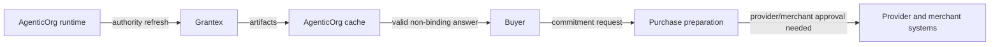

<Note>
Update, 20 October 2026. The principle holds: non-binding buyer questions never pass through Grantex. A purchase now makes a small number of calls to Grantex: for its Intent, Cart and Payment mandates and for the countersignature of AgenticOrg's arbiter decision. Grantex still does not execute payment, and it does not decide the purchase. Current status: [OACP runtime launch closure PRD](/guides/oacp/runtime-launch-closure-prd).
</Note>

## Summary

Grantex is the OACP authority, not a relay for every buyer message. Valid cached artifacts let AgenticOrg answer non-binding questions while commitment requests remain gated by merchant, provider, bank, POS, and channel evidence.

## Target Audience

Architects, operators, and platform buyers.

## Architecture Diagram

## End-To-End Flow

Grantex signs the trust artifact. AgenticOrg stores a scoped cache. Buyer questions use the cache until freshness or revocation fails. Purchase requests must use approved merchant/provider/bank/POS/channel paths and cannot be converted into success by cache alone.

## What Is Implemented Now

The authority endpoint issues or refuses signed artifacts, and every issue and refusal is kept. AgenticOrg verifies them before caching; its cache and bridge routes consume them for Q&A and prepared handoff. AgenticOrg merchant config records Shopify runtime setup plus WooCommerce/ERP/bank/custom provider pending-adapter intent without making Grantex the config owner.

## What Requires External Approval Or Config

Public tenant launch, provider or bank rail execution, POS callback approval, and channel rollout.

## Failure Modes

- Cache used past TTL.
- Commitment request treated like a discovery request.
- Grantex outage misunderstood as permission to execute.

## Safe User Wording Examples

- "Grantex signed the source artifact; AgenticOrg answered from valid cache."
- "A valid cache supports discovery, not payment authority."
- "This request needs provider or merchant approval before execution."

## Ownership

Grantex is owned by Orchestrum Technologies LLP. Inventor and owner: Sanjeev Kumar. Ownership contact: [sanjeev@orchestrum.in](mailto:sanjeev@orchestrum.in) or [mishra.sanjeev@gmail.com](mailto:mishra.sanjeev@gmail.com).
