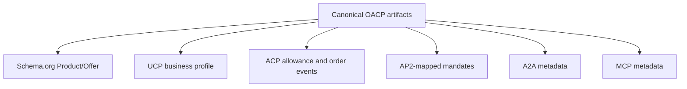

<Note>
Update, 20 October 2026. Grantex no longer serves preview adapters for UCP, ACP or AP2. It renders a UCP business profile from issued artifacts, issues the ACP delegate-payment allowance and order events, and issues Intent, Cart and Payment mandates mapped to AP2 v0.2 member names. See [OACP explained](/blog/oacp-one-trust-layer-under-ucp-acp-ap2) and [OACP runtime launch closure PRD](/guides/oacp/runtime-launch-closure-prd).
</Note>

## Summary

OACP is the canonical trust artifact. Protocol adapters project OACP facts into known client and partner shapes while preserving source, freshness, and non-execution boundaries.

## Target Audience

Protocol partners, developers, and technical reviewers.

## Architecture Diagram

## End-To-End Flow

Grantex issues OACP artifacts. AgenticOrg caches them. Adapter payloads are generated from those artifacts for a channel. Unsupported fields stay unsupported instead of being filled with guessed execution state.

## What Is Implemented Now

Grantex contains a Schema.org preview helper, renders a UCP business profile from issued OACP artifacts, issues the ACP delegate-payment allowance and order events, and issues AP2-mapped Intent, Cart and Payment mandates. The earlier unsigned UCP-style, ACP-style, and AP2-style preview routes were removed. AgenticOrg generates its own protocol adapter payloads (Schema.org, A2A, MCP and OpenAPI views among them) from the artifacts it has verified.

## What Requires External Approval Or Config

Any external program claim requires partner review and published evidence. Current docs describe compatibility mapping only.

## Failure Modes

- Adapter field has no canonical artifact lineage.
- Adapter implies checkout or payment execution.
- Source or freshness labels are dropped.

## Safe User Wording Examples

- "This is an OACP compatibility mapping."
- "The payload is buyer-safe metadata, not payment authority."
- "Unsupported execution fields are omitted or blocked."

## Ownership

Grantex is owned by Orchestrum Technologies LLP. Inventor and owner: Sanjeev Kumar. Ownership contact: [sanjeev@orchestrum.in](mailto:sanjeev@orchestrum.in) or [mishra.sanjeev@gmail.com](mailto:mishra.sanjeev@gmail.com).
