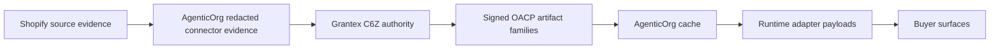

# OACP Runtime Authority And Adapter Mappings

Canonical docs now start at `docs/guides/oacp/overview.mdx`. This page is
retained as an implementation note for the C6Z authority route and adapter
mapping payloads.

Grantex is the OACP trust, protocol, policy, artifact signing, verification,
and adapter-governance authority. AgenticOrg is the buyer/seller agent runtime
that operates Shopify connector sync, artifact cache, buyer channels, and
provider-owned mandate capability verification.

Grantex must not become a toll booth for every buyer/seller agent interaction.
AgenticOrg may answer non-binding buyer questions from valid cached artifacts
while TTL, freshness, revocation, scope, and verifier state remain usable.

## C6Z Authority Route

`POST /v1/commerce/oacp/c6z/authority-requests` accepts AgenticOrg
route-scoped service-token requests for allowlisted tenants. It issues or
refuses OACP artifacts, each signed with an ES256 detached JWS by a Grantex OACP
issuer key published in `/.well-known/jwks.json` and listed on an OACP Token Status List, for:

- `merchant_profile`
- `seller_agent_card`
- `connector_evidence`
- `catalog_snapshot`
- `offer_price_snapshot`
- `inventory_snapshot`
- `policy_scope`
- `public_discovery_state`
- `mandate_capability`
- `protocol_adapter`
- `authority_request_status`

The route is not a checkout, payment, order, mandate, provider, Shopify, or
merchant private API path.

## Protocol Adapter Governance

The `protocol_adapter` artifact carries a canonical mapping profile. It tells
AgenticOrg which artifact families must feed each compatibility payload:
Schema.org Product/Offer JSON-LD, UCP-style capability profile, ACP-style
commerce interaction profile, AP2-style mandate/payment evidence profile, A2A
task metadata, MCP tool/resource metadata, and OpenAPI buyer-safe bridge schema.

These are compatibility mappings only. They are not public protocol
certification, standards publication, public discovery approval, checkout
enablement, or payment execution.

## UCP Business Profile

`GET /v1/commerce/oacp/ucp-profile` renders the `ucp` member of a UCP business
profile from the merchant / seller-agent scope's issued artifacts, at UCP
`2026-04-08` (default) or `2026-08-25`. Callers: the AgenticOrg service token
(scope `commerce.oacp.ucp_profile.read`, allow-listed tenant), an operator of
the tenant, or the platform admin.

| Query | Meaning |
|---|---|
| `tenant_id`, `merchant_id`, `seller_agent_id` | Required artifact scope. |
| `version` | `2026-04-08` or `2026-08-25`. |
| `served` | Comma-separated `dev.ucp.*` capabilities the business host serves. |
| `rest_endpoint` | The host's UCP REST base URL (https, no trailing slash); adds the `dev.ucp.shopping` REST service. |
| `identity_linking_scopes` | Scope tokens the merchant's authorization server issues (see `@grantex/mcp-auth` identity linking). |

A capability is rendered only when it is served and every artifact family that
backs it is `issued`, unrevoked and unexpired:

| Capability | Backing artifact families |
|---|---|
| `dev.ucp.shopping.catalog.search`, `dev.ucp.shopping.catalog.lookup`, `dev.ucp.shopping.cart` | `merchant_profile`, `seller_agent_card`, `catalog_snapshot`, `offer_price_snapshot`, `inventory_snapshot` |
| `dev.ucp.shopping.checkout` | the above plus `policy_scope`, `mandate_capability` |
| `dev.ucp.shopping.order` | as checkout, and only when checkout is rendered |
| `dev.ucp.common.identity_linking` | `merchant_profile`, `seller_agent_card`; `config.scopes` keeps only scopes of rendered capabilities |

Everything not rendered is listed in `withheld` (`not_served`,
`missing_backing_artifact` with the missing families, `requires_checkout`,
`no_identity_linking_scopes`). Every entry declares the profile's
`ucp.version` and points `spec` / `schema` at ucp.dev for that release.
`payment_handlers` is empty until a payment handler is backed. The response
also carries `source_artifacts`, `valid_until` (earliest source expiry:
re-render by then) and `publication_allowed` (from `public_discovery_state`;
the host must not publish while it is false). The host adds its signing keys
(`signing_keys[]` at 2026-04-08, `keys[]` at 2026-08-25) and serves the result
at `/.well-known/ucp`. No Grantex-private namespace is emitted: the former
`dev.grantex.commerce.discovery.preview` preview and the UCP-style and
ACP-style preview routes are removed.

## ACP Delegate-Payment Allowance

`POST /v1/commerce/oacp/acp/delegate-payment-allowance` (AgenticOrg service
token with scope `commerce.acp.delegate_payment_allowance.issue`, an operator of
the tenant, or the platform admin). Body: `tenant_id`, `passport_jwt` (a
checkout Commerce Passport), `checkout_session_id`, optional `merchant_id`,
`amount` (minor units) and `currency`. Grantex verifies the passport
payment-affecting (signature, expiry, online revocation, tenant, merchant),
requires `commerce:payment.initiate` and a cap, and answers:

| Member | Value |
|---|---|
| `allowance` | ACP `Allowance`: `reason: one_time`, `max_amount` = passport `max_amount`, `currency` lowercase, `checkout_session_id`, `merchant_id` = passport merchant, `expires_at` = passport `exp`. |
| `risk_signals` | `[]`. ACP defines only `card_testing`, which Grantex does not score. |
| `metadata` | String map for `DelegatePaymentRequest.metadata`: passport `jti`, agent, environment. |
| `authority` | The checks performed, passport `jti`, agent, environment, policy version. |
| `audit_event_id` | The `commerce_audit_events` row recording the allowance. |

The PSP-facing `DelegatePaymentRequest` (payment method, billing address,
signature) is built and sent by the merchant runtime to its PSP. Grantex never
receives card data: any payment-method member in the body is refused with 422
`card_data_refused`. An `amount` above the cap is refused with
`allowance_exceeds_passport_cap`; every refusal is audited.

## Buyer Identity Linking

UCP identity linking needs an OAuth 2.0 authorization server on the merchant's
domain. `@grantex/mcp-auth` serves it: configure
`commerce.ucpIdentityLinking` (UCP release and well-known `dev.ucp.*` scopes)
and, for ACP operations, `commerce.acpDelegatedAuthentication` (the Grantex
`dev.grantex.acp.*` extension scopes). The buyer signs in to the merchant
account, approves the scopes, and the platform receives a Grantex grant token
audience-bound to the merchant resource. The merchant (AgenticOrg) verifies it
against the Grantex JWKS and links (`iss`, `sub`) to the merchant account; the
`onTokenIssued` hook reports the same link at issuance. Pass the offered UCP
scopes (`grantex_extensions.commerce.ucp_identity_linking.scopes` in the
authorization server metadata) as `identity_linking_scopes` to the UCP profile
route. Flow and claims: `packages/mcp-auth/README.md`.

## Refusal Rules

Grantex refuses stale, unsafe, private, raw, enabling, scope-mismatched, or
non-read-only authority requests. AgenticOrg must turn those refusals into
safe operator blockers rather than silently falling back to raw Shopify or
provider payloads.

## Ownership

Grantex is owned by Orchestrum Technologies LLP. Inventor and owner: Sanjeev Kumar. Ownership contact: [sanjeev@orchestrum.in](mailto:sanjeev@orchestrum.in) or [mishra.sanjeev@gmail.com](mailto:mishra.sanjeev@gmail.com).
