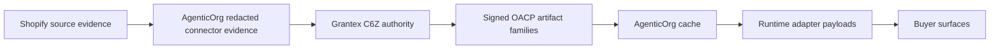

# OACP Runtime Authority And Adapter Mappings

Canonical docs now start at `docs/guides/oacp/overview.mdx`. This page is
retained as an implementation note for the C6Z authority route and adapter
mapping payloads.

Grantex is the OACP trust, protocol, policy, artifact signing, verification,
and adapter-governance authority. AgenticOrg is the buyer/seller agent runtime
that operates Shopify connector sync, artifact cache, buyer channels, and
provider-owned mandate capability verification.

Grantex must not become a toll booth for every buyer/seller agent interaction.
AgenticOrg may answer non-binding buyer questions from valid cached artifacts
while TTL, freshness, revocation, scope, and verifier state remain usable.

## C6Z Authority Route

`POST /v1/commerce/oacp/c6z/authority-requests` accepts AgenticOrg
route-scoped service-token requests for allowlisted tenants. It issues or
refuses OACP artifacts, each signed with an ES256 detached JWS by a Grantex OACP
issuer key published in `/.well-known/jwks.json` and listed on an OACP Token Status List, for:

- `merchant_profile`
- `seller_agent_card`
- `connector_evidence`
- `catalog_snapshot`
- `offer_price_snapshot`
- `inventory_snapshot`
- `policy_scope`
- `public_discovery_state`
- `mandate_capability`
- `protocol_adapter`
- `authority_request_status`

The route is not a checkout, payment, order, provider, Shopify, or merchant
private API path. Mandates have their own routes (see "AP2-Mapped Mandates"
below). Issuance needs an active OACP issuer key (`503
oacp_issuer_key_unavailable` otherwise), and relying parties can check the
status list only while `OACP_STATUS_LIST_PUBLIC_ENABLED` is on.

### Public discovery opt-in

By default every request carries `no_public_discovery_enablement: true` and
`public_discovery_state` is issued `disabled`. A merchant opts in with
`public_discovery_requested: true` (and `no_public_discovery_enablement`
false or absent; `no_payment_execution: true` stays mandatory), an opaque
`namespace_attestation_ref` (the merchant runtime's namespace-to-host
attestation) and `serving_host` (lower-case DNS name). Grantex issues
`public_discovery_state` with `public_discovery_state: "enabled"`,
`public_discovery_publication_allowed: true`, the attestation ref and serving
host bound into the signed payload, `no_public_discovery_enablement: false`, and
`public_discovery_publication` removed from that artifact's blocked and
unsupported capability lists, only when all of these hold:

| Condition | Otherwise `public_discovery_withheld_reason` |
|---|---|
| `OACP_PUBLIC_DISCOVERY_ISSUANCE_ENABLED=true` (default off) | `issuance_flag_off` |
| The tenant is on `COMMERCE_C6Z_AUTHORITY_SERVICE_TENANTS` | `tenant_not_allowlisted` |
| Both `namespace_attestation_ref` and `serving_host` are present | `namespace_attestation_missing` |

When a condition fails the artifact set is issued exactly as without the
opt-in (disabled), plus `public_discovery_requested: true` and the withheld
reason on the `public_discovery_state` artifact. Every other family keeps
public discovery blocked. A malformed opt-in is refused with
`public_discovery_request_invalid`. A request without the opt-in issues the
same payload as before.

## Protocol Adapter Governance

The `protocol_adapter` artifact carries a canonical mapping profile. It tells
AgenticOrg which artifact families must feed each compatibility payload:
Schema.org Product/Offer JSON-LD, the UCP capability profile, the ACP commerce
interaction profile, the AP2 mandate and payment evidence profile, A2A task
metadata, MCP tool/resource metadata, and OpenAPI buyer-safe bridge schema.
The signed payload still labels three of these surfaces with their earlier
names (`ucp_style_capability_profile`, `acp_style_commerce_interaction` /
`acp_style_commerce_interaction_profile`,
`ap2_style_mandate_payment_evidence_profile`); `adapter_surfaces` lists
`ap2_payment_mandate`. The labels are kept so AgenticOrg's reader does not
break; they name mapping lineage, not Grantex routes. The surfaces Grantex
serves are the UCP profile, the ACP allowance and order events and the
mandates described below.

These are compatibility mappings only. They are not public protocol
certification, standards publication, public discovery approval, checkout
enablement, or payment execution.

## UCP Business Profile

`GET /v1/commerce/oacp/ucp-profile` renders the `ucp` member of a UCP business
profile from the merchant / seller-agent scope's issued artifacts, at UCP
`2026-04-08` (default) or `2026-08-25`. Callers: the AgenticOrg service token
(scope `commerce.oacp.ucp_profile.read`, allow-listed tenant), an operator of
the tenant, or the platform admin.

| Query | Meaning |
|---|---|
| `tenant_id`, `merchant_id`, `seller_agent_id` | Required artifact scope. |
| `version` | `2026-04-08` or `2026-08-25`. |
| `served` | Comma-separated `dev.ucp.*` capabilities the business host serves. |
| `rest_endpoint` | The host's UCP REST base URL (https, no trailing slash); adds the `dev.ucp.shopping` REST service. |
| `identity_linking_scopes` | Scope tokens the merchant's authorization server issues (see `@grantex/mcp-auth` identity linking). |

A capability is rendered only when it is served and every artifact family that
backs it is `issued`, unrevoked and unexpired:

| Capability | Backing artifact families |
|---|---|
| `dev.ucp.shopping.catalog.search`, `dev.ucp.shopping.catalog.lookup`, `dev.ucp.shopping.cart` | `merchant_profile`, `seller_agent_card`, `catalog_snapshot`, `offer_price_snapshot`, `inventory_snapshot` |
| `dev.ucp.shopping.checkout` | the above plus `policy_scope`, `mandate_capability` with `mandate_capability_status: "verified"` (else withheld as `mandate_capability_unverified`) |
| `dev.ucp.shopping.order` | as checkout, and only when checkout is rendered |
| `dev.ucp.common.identity_linking` | `merchant_profile`, `seller_agent_card`; `config.scopes` keeps only scopes of rendered capabilities |

Everything not rendered is listed in `withheld` (`not_served`,
`missing_backing_artifact` with the missing families, `requires_checkout`,
`no_identity_linking_scopes`). Every entry declares the profile's
`ucp.version` and points `spec` / `schema` at ucp.dev for that release.
`payment_handlers` is empty until a payment handler is backed. The response
also carries `source_artifacts`, `valid_until` (earliest source expiry:
re-render by then), `publication_allowed` and `public_discovery`.
`publication_allowed` is true only when the live `public_discovery_state`
artifact is `enabled` with `public_discovery_publication_allowed: true`, a
`serving_host` and a `namespace_attestation_ref`, and, when `rest_endpoint` is
given, its host equals that `serving_host`; `public_discovery` then echoes the
host and attestation ref. The host must not publish while it is false. When a live
artifact of the scope was issued from the synthetic demo source (`synthetic_data: true`
in its signed payload), the response also carries `synthetic_data: true`, and the host
must present the profile as a demonstration; otherwise the member is absent. The host adds its signing keys
(`signing_keys[]` at 2026-04-08, `keys[]` at 2026-08-25) and serves the result
at `/.well-known/ucp`. No Grantex-private namespace is emitted: the former
`dev.grantex.commerce.discovery.preview` preview and the UCP-style and
ACP-style preview routes are removed.

## ACP Delegate-Payment Allowance

`POST /v1/commerce/oacp/acp/delegate-payment-allowance` (AgenticOrg service
token with scope `commerce.acp.delegate_payment_allowance.issue`, an operator of
the tenant, or the platform admin). Body: `tenant_id`, `passport_jwt` (a
checkout Commerce Passport), `checkout_session_id`, optional `merchant_id`,
`amount` (minor units) and `currency`. Grantex verifies the passport
payment-affecting (signature, expiry, online revocation, tenant, merchant),
requires `commerce:payment.initiate` and a cap, and answers:

| Member | Value |
|---|---|
| `allowance` | ACP `Allowance`: `reason: one_time`, `max_amount` = passport `max_amount`, `currency` lowercase, `checkout_session_id`, `merchant_id` = passport merchant, `expires_at` = passport `exp`. |
| `risk_signals` | `[]`. ACP defines only `card_testing`, which Grantex does not score. |
| `metadata` | String map for `DelegatePaymentRequest.metadata`: passport `jti`, agent, environment. |
| `authority` | The checks performed, passport `jti`, agent, environment, policy version. |
| `audit_event_id` | The `commerce_audit_events` row recording the allowance. |

The PSP-facing `DelegatePaymentRequest` (payment method, billing address,
signature) is built and sent by the merchant runtime to its PSP. Grantex never
receives card data: any payment-method member in the body is refused with 422
`card_data_refused`. An `amount` above the cap is refused with
`allowance_exceeds_passport_cap`; every refusal is audited.

## ACP Order Events

`GET /v1/commerce/oacp/acp/orders/{order_id}/event?tenant_id=&permalink_base=`
(AgenticOrg service token with scope `commerce.acp.order_events.read`, an
operator of the tenant, or the platform admin) returns `{event}`: the ACP
2026-04-17 webhook body `{type, data}` for a Grantex order, always the full
snapshot.

| ACP member | From the Grantex order |
|---|---|
| `type` | `order_create` when the order was never updated and has no handoffs, else `order_update`; `event_type` overrides. |
| `data.id` | Order id. |
| `data.checkout_session_id` | `checkout_session_id` query, else the cart, else the payment intent (409 when none). |
| `data.permalink_url` | `permalink_base` + `/` + order id (https only). |
| `data.status` | `pending_source_facts` created, `recorded` confirmed, `merchant_acknowledged` processing, `closed` completed, `cancelled` / `expired` canceled, `blocked` / `unknown` manual_review. |
| `data.line_items[]` | One per line: `id` (variant), `title`, `product_id`, `quantity {ordered, current, fulfilled: 0}`, `unit_price` and `subtotal` only when the price is known, `status` (`removed` on a cancelled or expired order). |
| `data.totals[]` | `subtotal`, `tax`, `total` when known. |
| `data.fulfillments[]` | Fulfillment / delivery handoffs whose safe `fulfillment_method` is `shipping`, `pickup` or `digital`. |
| `data.adjustments[]` | Refund / return handoffs: status `pending`, `completed` (resolved) or `failed`; `amount` from the safe `amount_minor_units`. |

No buyer, agent, audit, SKU or provider identifiers are emitted. The merchant
runtime signs the exact body it sends with
`Merchant-Signature: t=<unix>,v1=<hex HMAC-SHA256(secret, t + "." + body)>`
(receivers allow 300 s) and posts it to the agent platform; Grantex sends no
outbound webhooks. Shared signature vectors:
`spec/examples/acp/merchant-signature-v1.json`.

## AP2-Mapped Mandates

`POST /v1/commerce/oacp/mandates/intent`, `.../cart` and `.../payment` issue
Intent, Cart and Payment mandates as ES256 JWTs signed by the OACP issuer key,
with claims that use AP2 v0.2 member names (`checkout_hash`,
`transaction_id`, constraints, `cnf`). They are plain JWTs mapped to AP2, not
AP2 v0.2 SD-JWT VCs. Each is on the OACP Token Status List; revoking one
revokes the mandates issued under it, and suspension is reversible. A
`human_present` cart needs a passkey assertion over its `checkout_hash` (a
Grantex extension). Request shapes, refusal codes and the verification order:
`docs/guides/oacp/agenticorg-integration.mdx`; decision and AP2 mapping:
`docs/guides/oacp/mandates-decision.mdx`.

## Settlement Receipts As Commitment Evidence

`POST /v1/commerce/oacp/commitment-evidence/settlement-receipts` (AgenticOrg
service token with scope `commerce.oacp.commitment_evidence.write`, allow-listed
tenant) binds a successful x402 SettlementResponse or MPP `Payment-Receipt` to
a commitment as a signed `commitment_evidence` artifact: `commitment_type:
settlement_receipt_reference`, the receipt's SHA-256 over its RFC 8785 form,
network or method, transaction reference, never the payer, and
`receipt_verification: reported_not_verified_by_grantex`, because neither
receipt format is signed. One receipt per commitment: the same receipt again
answers `200`, another answers `409`.

## Buyer Identity Linking

UCP identity linking needs an OAuth 2.0 authorization server on the merchant's
domain. `@grantex/mcp-auth` serves it: configure
`commerce.ucpIdentityLinking` (UCP release and well-known `dev.ucp.*` scopes)
and, for ACP operations, `commerce.acpDelegatedAuthentication` (the Grantex
`dev.grantex.acp.*` extension scopes). The buyer signs in to the merchant
account, approves the scopes, and the platform receives a Grantex grant token
audience-bound to the merchant resource. The merchant (AgenticOrg) verifies it
against the Grantex JWKS and links (`iss`, `sub`) to the merchant account; the
`onTokenIssued` hook reports the same link at issuance. Pass the offered UCP
scopes (`grantex_extensions.commerce.ucp_identity_linking.scopes` in the
authorization server metadata) as `identity_linking_scopes` to the UCP profile
route. Flow and claims: `packages/mcp-auth/README.md`.

## Refusal Rules

Grantex refuses stale, unsafe, private, raw, enabling, scope-mismatched, or
non-read-only authority requests. AgenticOrg must turn those refusals into
safe operator blockers rather than silently falling back to raw Shopify or
provider payloads.

## Ownership

Grantex is owned by Orchestrum Technologies LLP. Inventor and owner: Sanjeev Kumar. Ownership contact: [sanjeev@orchestrum.in](mailto:sanjeev@orchestrum.in) or [mishra.sanjeev@gmail.com](mailto:mishra.sanjeev@gmail.com).
