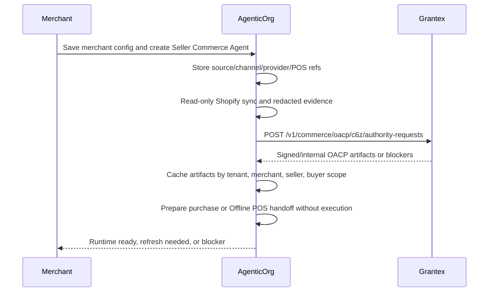

Canonical end-to-end flow: [OACP authority overview](./overview).

AgenticOrg calls Grantex only when it needs authority artifacts or verification. It does not route every buyer message through Grantex.

## Runtime Flow



## Request Contract

AgenticOrg sends:

- tenant, merchant, seller agent, and source identifiers;
- merchant self-service config refs for source connector, buyer channels, provider-owned payment rails, public publishing, and POS metadata;
- requested OACP artifact families;
- source observed timestamp;
- public-safe connector evidence;
- no raw Shopify credential, raw provider payload, checkout URL, or payment URL.
- no raw POS payload, raw payment payload, order-created claim, or POS paid-state claim.

Grantex returns:

- `201 artifact_issuance_ready` with artifact families when ready;
- `202 received` when connector evidence is still required;
- `422` when the request is private, stale, executable, or otherwise unsafe.

## Public Catalog Publishing Boundary

AgenticOrg publishes public buyer-safe seller and product surfaces after it has valid Shopify/OACP evidence and the operator enables public catalog publishing. Grantex does not host these catalog pages and does not sit in the hot path for non-binding buyer questions.

Expected AgenticOrg public surfaces:

| Surface | AgenticOrg route |
| --- | --- |
| Seller profile page | `GET /api/v1/public/commerce/sellers/{merchant_id}?tenant_id=...&seller_agent_id=...` |
| Buyer-safe catalog JSON | `GET /api/v1/public/commerce/sellers/{merchant_id}/catalog.json?tenant_id=...&seller_agent_id=...` |
| Product detail page | `GET /api/v1/public/commerce/sellers/{merchant_id}/products/{product_slug}?tenant_id=...&seller_agent_id=...` |
| Product detail JSON | `GET /api/v1/public/commerce/sellers/{merchant_id}/products/{product_slug}.json?tenant_id=...&seller_agent_id=...` |
| Schema.org JSON-LD | `GET /api/v1/public/commerce/sellers/{merchant_id}/schema-org.jsonld?tenant_id=...&seller_agent_id=...` |
| Sitemap | `GET /api/v1/public/commerce/sellers/{merchant_id}/sitemap.xml?tenant_id=...&seller_agent_id=...` |
| llms.txt | `GET /api/v1/public/commerce/sellers/{merchant_id}/llms.txt?tenant_id=...&seller_agent_id=...` |

Those outputs must include source and freshness labels, must not expose Shopify credentials or raw provider payloads, and must not claim checkout, payment, mandate, order, certification, or external platform approval. If the AgenticOrg cache is stale, revoked, or source-mismatched, the public surface must block or label the missing requirement instead of inventing facts.

## Required Configuration

| Config | Owner | Purpose |
| --- | --- | --- |
| `COMMERCE_C6Z_AUTHORITY_SERVICE_TOKEN` | Grantex + AgenticOrg | Service-token auth for authority requests, arbiter decisions and witness checkpoints. |
| `COMMERCE_C6Z_AUTHORITY_SERVICE_TENANTS` | Grantex | Tenant allowlist. |
| Shopify credential custody | AgenticOrg + merchant | Read-only source evidence generation. |
| Future connector config | AgenticOrg + merchant | WooCommerce, ERP, PIM, OMS, WMS, and custom API setup intent; not live until adapters exist. |
| Provider capability config | AgenticOrg + provider or bank | Capability evidence checks outside Grantex. |
| POS provider approval | AgenticOrg + merchant + POS/payment provider | Verified callback/evidence refs for Offline POS Bridge reconciliation. |

## Failure Handling

If Grantex is unavailable, AgenticOrg may answer non-binding buyer questions from valid cached artifacts. Commitment-bound or POS-bound requests must refresh, prepare no execution, use only valid cached policy when risk permits, or refuse.

## Arbiter Decisions

AgenticOrg's policy arbiter is authoritative and deterministic: it seals `allow` or `refuse` from the mandate, consent, Commerce Passport cap and OACP artifact evidence, and never waits for a person. It posts every sealed decision to Grantex, which only records and countersigns it.

`POST /v1/commerce/oacp/arbiter-decisions` uses the same service token and tenant allowlist as the authority route; developer, merchant and agent credentials are refused. The body:

```json
{
  "decision_id": "arb_dec_0001",
  "tenant_id": "cten_example",
  "merchant_id": "mch_example",
  "seller_agent_id": "seller-01",
  "buyer_agent_id": "shopper-01",
  "action": "purchase_handoff",
  "action_hash": "<lowercase hex SHA-256 of the RFC 8785 handoff payload>",
  "outcome": "allow",
  "rules_evaluated": ["mandate_present", "consent_granted", "passport_cap"],
  "failing_rule": null,
  "evidence": {
    "mandate_ref": "mandate:01", "mandate_hash": "<hex>", "consent_ref": "consent:01",
    "consent_status": "granted", "passport_ref": "passport:01", "artifact_ids": ["oacp_art_01"]
  },
  "decided_at": "2026-10-19T10:00:00Z",
  "policy_version": "2026-10-01"
}
```

| Outcome | Answer |
| --- | --- |
| `allow` (`failing_rule: null`) | `201 {decision_id, outcome, decision_grant, jti, exp, expires_at}`. `decision_grant` is a `decision+jwt` in the machine profile (`approver_auth: "policy_arbiter"`, `amr` from the evidence, no `acr`, `dwell_ms: 0`, `action_hash`, `decision_request` = `decision_id`, `sub` = `buyer_agent_id`), at most ten minutes long, signed with the platform key published at `/.well-known/jwks.json`. `exp` is seconds since the epoch. |
| `refuse` (`failing_rule` names one of `rules_evaluated`) | `201 {decision_id, outcome, recorded: true}`. Nothing is minted. |
| Same `decision_id`, same body | `200` with the first answer (same `jti` and `exp`). |
| Same `decision_id`, different body | `409 arbiter_decision_conflict`. |
| Malformed, an `allow` with no evidence, `decided_at` in the future, or an `allow` older than ten minutes | `422`; not stored. |

AgenticOrg verifies the returned `decision_grant` against the Grantex JWKS (`typ` `decision+jwt`, `aud` `urn:grantex:decision`, `approver_auth` `policy_arbiter`, `action_hash` equal to its own `payload_hash`) before storing the `jti` beside its decision row. Grantex's human decision-grant verifiers (`POST /v1/decisions/consume`, SDK `verifyDecisionGrant(s)` and `enforce()`) refuse a `policy_arbiter` grant, so it can never stand in for a human approval. The profile is specified in `spec/decision-grant.md` section 10.

## Witness Checkpoints

AgenticOrg anchors the head of its hash-chained `audit_log` and asks Grantex to witness it, so a later rewrite below a witnessed head is provable outside AgenticOrg.

`POST /v1/audit/witness-checkpoints` (same AgenticOrg service token) takes `{source: "agenticorg", tenant_ref, chain: "audit_log", head_seq, head_hash, anchored_at}` (`head_hash` lowercase hex SHA-256) and answers `201 {witness_id, countersignature, witnessed_at, created: true}`. `countersignature` is a compact JWS (`typ` `audit-witness+jwt`, platform key, `kid` in `/.well-known/jwks.json`) over those fields plus `witnessed_at`, with `jti` = `witness_id` and no `exp`.

| Case | Answer |
| --- | --- |
| Same `(source, tenant_ref, chain, head_seq, head_hash)` again | `200` with the stored witness and countersignature (`created: false`). |
| A different `head_hash` for a witnessed `(source, tenant_ref, chain, head_seq)` | `409 WITNESS_FORK`; `fork` holds the witnessed checkpoint (with its countersignature) and the presented hash. The attempt is recorded. |
| Malformed, or `anchored_at` more than five minutes ahead | `400`. |

`GET /v1/audit/witness-checkpoints?source=agenticorg&tenant_ref=...&limit=...` returns `{checkpoints, forks}`, newest `head_seq` first. AgenticOrg verifies the countersignature against the Grantex JWKS before storing the `witness_id` beside its anchor row, and treats a `WITNESS_FORK` as an irregularity of its own chain.

## Ownership

Grantex is owned by Orchestrum Technologies LLP. Inventor and owner: Sanjeev Kumar. Ownership contact: [sanjeev@orchestrum.in](mailto:sanjeev@orchestrum.in) or [mishra.sanjeev@gmail.com](mailto:mishra.sanjeev@gmail.com).
