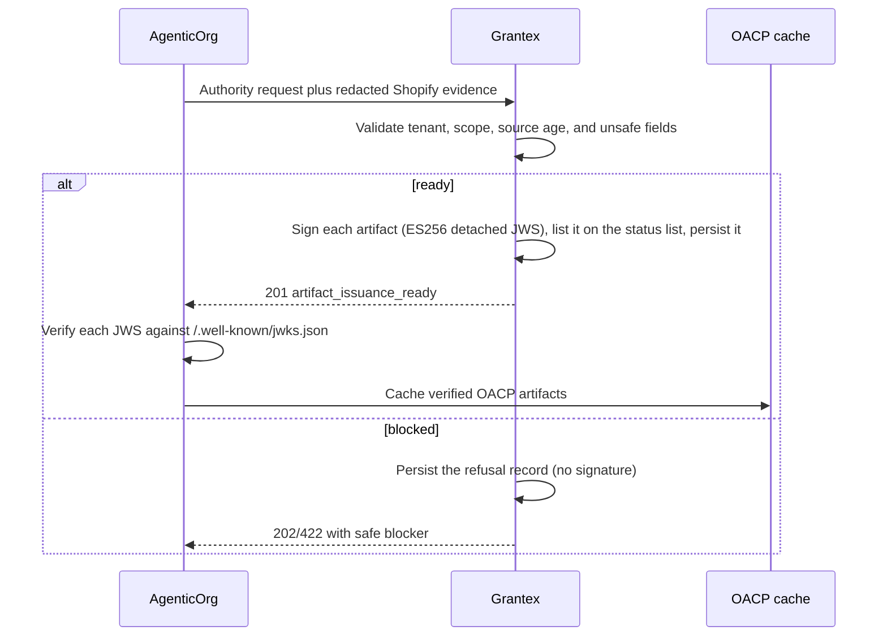

Canonical end-to-end flow: [OACP authority overview](./overview).

Grantex authority is exposed through `POST /v1/commerce/oacp/c6z/authority-requests`. The route accepts an AgenticOrg seller authority request and public-safe connector evidence, validates scope, and returns issued artifacts or a refusal.

## Artifact Families

| Family | Purpose |
| --- | --- |
| `merchant_profile` | Merchant identity and public profile evidence. |
| `seller_agent_card` | Seller Commerce Agent identity and runtime boundary. |
| `connector_evidence` | Public-safe source evidence from AgenticOrg connector custody. |
| `catalog_snapshot` | Product catalog facts from Shopify or merchant source. |
| `offer_price_snapshot` | Price and offer facts with freshness metadata. |
| `inventory_snapshot` | Inventory/availability facts with source time. |
| `policy_scope` | Merchant and Grantex policy boundaries. |
| `public_discovery_state` | Whether buyer-safe discovery may be shown. |
| `mandate_capability` | Provider-owned capability evidence requirement and state. |
| `protocol_adapter` | Compatibility mapping metadata. |
| `authority_request_status` | Request result and blocker state. |

## Canonical JSON

Payloads are canonicalised with RFC 8785 (JCS) after members whose value is absent are
removed, and `payload_hash` is the lowercase hex SHA-256 of those UTF-8 bytes
(`canonicalizeOacpPayload` / `hashOacpPayload`). Python verifiers produce the same bytes with
`json.dumps(value, sort_keys=True, separators=(",", ":"), ensure_ascii=False)`, since OACP
values carry no floating-point numbers. The shared vectors in
`spec/examples/oacp/oacp-artifact-jws-v1.json` pin a payload whose member names
(`a_b`/`ab`, `Zeta_upper`) sort differently under the older locale-based order, which was not
RFC 8785; that order is no longer used for OACP. Commerce idempotency hashes keep their own
stored format and are unchanged.

## Verification Rules

Artifacts must carry issuer, issuer key, artifact type, issued/expires timestamps, payload hash, signature algorithm, source refs, freshness metadata, revocation posture, risk tier, and `no_checkout_payment_enablement` behavior. Payloads must not contain raw connector payloads, tokens, provider secrets, card or bank data, checkout URLs, payment URLs, executable targets, or private merchant data.

## Signature (OACP artifact JWS profile v1)

Every issued artifact is signed. The signature is checked by Grantex before the artifact is
returned and can be checked by any relying party against the published JWKS.

- `envelope.signature` is a detached compact JWS (RFC 7515 Appendix F):
  `BASE64URL(header) + ".." + BASE64URL(signature)`.
- The protected header is exactly `{"alg":"ES256","kid":<issuer_key_id>,"typ":"oacp-artifact+jws"}`.
- The JWS Signing Input is `BASE64URL(header) + "." + BASE64URL(JCS(envelope without "signature"))`.
  The whole envelope is signed: scope, timestamps, `payload_hash`, `status`, `safety`.
- ES256 on P-256; the signature is the 64-byte r||s (RFC 7518 §3.4).
- `envelope.issuer` is the Grantex issuer identifier (`JWT_ISSUER`); `envelope.schema_version`
  is `oacp.artifact.v1`; `envelope.signature_alg` is `ES256`.
- Code: `apps/auth-service/src/lib/commerce/oacp-jws.ts` (`signOacpEnvelope`,
  `verifyOacpArtifact`). Shared vectors: `spec/examples/oacp/oacp-artifact-jws-v1.json`.

Verification runs in this order, and every verifier refuses with the same code:

| Step | Check | Refusal |
| --- | --- | --- |
| 1 | `signature` is three base64url parts with an empty middle | `signature_missing_or_placeholder` |
| 2 | `signature_alg` is `ES256` | `signature_algorithm_unsupported` |
| 3 | `payload_hash` recomputes from the payload | `payload_hash_mismatch` |
| 4 | header is exactly `alg`/`kid`/`typ`, `kid` equals `issuer_key_id` | `detached_jws_verification_failed` |
| 5 | exactly one usable EC P-256 `sig` key with that `kid` (prefix `oacp-`) in the JWKS | `issuer_key_untrusted` |
| 6 | ECDSA verification over the signing input | `detached_jws_verification_failed` |
| 7 | payload safety, `issued_at`/`not_before` (60 s skew), expiry, pinned TTL, expected scope | `artifact_missing_or_invalid`, `artifact_not_yet_valid`, `artifact_expired_or_stale`, `artifact_ttl_exceeds_default`, `artifact_scope_mismatch` |
| 8 | the artifact's Token Status List entry | `artifact_revoked` (1), `artifact_suspended` (2), `revocation_status_unavailable` (list missing, unreadable or invalid) |

## Issuer Keys

- OACP issuer keys live in `oacp_issuer_keys` (migration `133_oacp_issuer_keys_artifacts.sql`).
  Private JWKs are encrypted with the vault key, bound to their kid. Kids look like
  `oacp-YYYYMMDD-<16 hex>`.
- One key is `active`. `POST /v1/commerce/oacp/issuer-keys/rotate` creates a new active key and
  retires the previous one; with no key it creates the first.
- `GET /.well-known/jwks.json` publishes the active key and every retired key until all the
  artifacts it signed have expired, plus a 600 s grace window, as
  `{"kty":"EC","crv":"P-256","x":...,"y":...,"kid":"oacp-...","alg":"ES256","use":"sig"}`.
- `POST /v1/commerce/oacp/issuer-keys/:kid/revoke` withdraws a key from the JWKS at once; every
  artifact it signed then fails with `issuer_key_untrusted`.
- With no active key, issuance answers `503 oacp_issuer_key_unavailable`. Outside production,
  `OACP_AUTO_GENERATE_ISSUER_KEY=true` creates a key on first use.

## Status List and Revocation

- Every issued artifact gets an entry on an OACP Token Status List (draft-ietf-oauth-status-list,
  2 bits: 0 VALID, 1 INVALID, 2 SUSPENDED). The envelope carries
  `status: {"status_list": {"idx": <int>, "uri": "<PUBLIC_BASE_URL>/status/oacp/<list>"}}`, and
  `revocation_status_url` is the same https URI. Issuance refuses a non-https `PUBLIC_BASE_URL`.
  For a local stack only, `OACP_ALLOW_LOOPBACK_HTTP=true` (default off, ignored when `NODE_ENV`
  is production) also accepts `http://` on a loopback host (`localhost`, 127.0.0.0/8, `::1`);
  relying parties verify such artifacts only with the SDKs' `allowLoopbackHttp` option.
- `GET /status/oacp/:list` serves the list as `application/statuslist+jwt`, signed with the platform
  signing key like the registry acceptance lists (kid in the same JWKS), `sub` the list URI,
  `ttl` 30 s, `exp` one hour after `iat`. It is unauthenticated and registered only when
  `OACP_STATUS_LIST_PUBLIC_ENABLED=true` (default off; a flag separate from
  `REGISTRY_PUBLIC_ENDPOINTS_ENABLED`). With it off, relying parties cannot read status and
  must refuse with `revocation_status_unavailable`.
- Revoking an artifact sets its entry INVALID (final), marks the row `revoked`, and issues a
  signed `revocation` artifact whose payload names the revoked `artifact_id`; the revocation
  artifact is itself on the status list. The `revocation` family TTL is 24 hours (86400 s),
  the longest family TTL, and a revocation artifact expires at the later of the revoked
  artifact's expiry and five minutes after revocation.

## Persistence and Replay

Every issued artifact, and every refused issuance, is a row in `oacp_artifacts`. Issued rows are
written in the same transaction as their status-list entries. Refused rows carry
`refusal_code` and a public-safe record, never a signature or a status entry.

Internal routes (same caller rules as the authority route: the AgenticOrg service token for an
allow-listed tenant, an operator for its own commerce tenant, or the platform admin):

| Route | Answer |
| --- | --- |
| `GET /v1/commerce/oacp/artifacts/:artifactId` | `{artifact_id, family, artifact_type, tenant_id, merchant_id, seller_agent_id, envelope, payload, status, status_list, issued_at, expires_at, refusal_code, revoked_at, revocation_reason, revocation_artifact_id, created_at}`; `status` is `issued`, `refused` or `revoked`. 404 for another tenant's artifact. |
| `GET /v1/commerce/oacp/artifacts?tenant_id=&merchant_id=&seller_agent_id=&since=&cursor=&limit=` | `{artifacts: [<same items>], next_cursor}` in creation order; `tenant_id` required; `since` inclusive (RFC 3339); `cursor` is the previous page's `next_cursor`; `limit` 1-500, default 100. |
| `POST /v1/commerce/oacp/artifacts/:artifactId/revoke` body `{reason_code?}` | `201 {artifact_id, status: "revoked", revoked_at, revocation_reason, already_revoked: false, revocation_artifact: {artifact_id, envelope, payload}}`; repeating it answers 200 with the same revocation artifact and `already_revoked: true`; a refusal record or a revocation artifact answers 409 `artifact_not_revocable`. |

The authority route stamps artifacts with the issuer's clock; a `now_iso` in the request body is
ignored. Artifact ids are `oacp_art_<ULID>`, unique per issuance.

## Ownership

Grantex is owned by Orchestrum Technologies LLP. Inventor and owner: Sanjeev Kumar. Ownership contact: [sanjeev@orchestrum.in](mailto:sanjeev@orchestrum.in) or [mishra.sanjeev@gmail.com](mailto:mishra.sanjeev@gmail.com).
