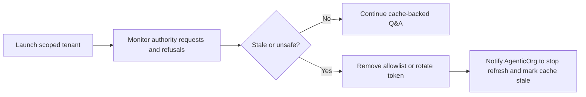

Canonical end-to-end flow: [OACP authority overview](./overview).

OACP authority is launch-ready only for the scoped path where Grantex issues signed artifacts to an allowlisted AgenticOrg tenant and AgenticOrg verifies them and uses them for non-binding buyer answers or purchase decisions. In production this needs the first OACP issuer key and `OACP_STATUS_LIST_PUBLIC_ENABLED`, neither of which was in place on 2026-10-20 ([turn-on order](./operator-runbook#production-turn-on-order)).

## Readiness Matrix

| Gate | Required evidence |
| --- | --- |
| Runtime route | Authority endpoint merged and protected by operator/service auth. |
| Tenant allowlist | AgenticOrg tenant explicitly allowlisted. |
| Source evidence | Shopify read-only sync evidence is redacted and timestamped. |
| Issuer key and status list | An `oacp-` key in `/.well-known/jwks.json`; `GET /status/oacp/:list` served. |
| Artifact issue/refuse | All 11 families issue for valid evidence and verify with the SDK verifier; unsafe requests refuse and are recorded. |
| Adapter mapping | Schema.org, UCP (spec-shape business profile), ACP (order events, delegate-payment allowance), AP2 (mapped mandates), A2A, MCP, and OpenAPI mappings derive from OACP artifacts. |
| Cache behavior | Valid cache can answer non-binding questions; stale cache blocks commitment. |
| Provider boundary | Plural/Pine capability evidence is provider-owned and redacted. |
| Rollback | Tenant removal and service-token rotation tested. |

## Launch And Rollback Diagram

## Do Not Claim

Do not claim official protocol approval, broad payment support, all-buyer purchase support, or payment/order success. Current OACP authority supports signed trust artifacts, mandates, countersigned arbiter decisions, compatibility mapping, cache-backed discovery, and provider-owned execution boundaries.

## Ownership

Grantex is owned by Orchestrum Technologies LLP. Inventor and owner: Sanjeev Kumar. Ownership contact: [sanjeev@orchestrum.in](mailto:sanjeev@orchestrum.in) or [mishra.sanjeev@gmail.com](mailto:mishra.sanjeev@gmail.com).
