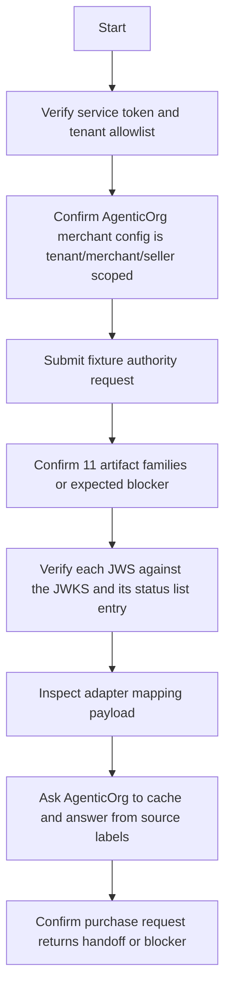

Canonical end-to-end flow: [OACP authority overview](./overview). Launch closure source of truth: [OACP Runtime Launch Closure PRD](./runtime-launch-closure-prd).

## Provision AgenticOrg Authority Access

1. Store `COMMERCE_C6Z_AUTHORITY_SERVICE_TOKEN` through the production secret path.
2. Optionally add bootstrap tenant ids to `COMMERCE_C6Z_AUTHORITY_SERVICE_TENANTS`. Merchant
   tenants no longer need an entry here: AgenticOrg enrols each one itself (see
   [Service-Tenant Enrolment](#service-tenant-enrolment)).
3. Deploy or restart the Grantex auth service with both values available. `PUBLIC_BASE_URL` must be
   https (status list URIs are built from it).
4. Create the first OACP issuer key: `POST /v1/commerce/oacp/issuer-keys/rotate` with the platform
   admin key. Confirm its `kid` (`oacp-...`) appears in `GET /.well-known/jwks.json`.
5. Set `OACP_STATUS_LIST_PUBLIC_ENABLED=true` and restart when relying parties are ready to check
   status; until then they refuse artifacts with `revocation_status_unavailable`.
6. Submit a fixture `POST /v1/commerce/oacp/c6z/authority-requests` for that tenant.
   Public discovery stays disabled unless `OACP_PUBLIC_DISCOVERY_ISSUANCE_ENABLED=true` and the
   request opts in (`public_discovery_requested: true` with `namespace_attestation_ref` and
   `serving_host`); turn the flag on only after the owner approves publishing UCP profiles.
7. Confirm `artifact_count = 11`, or record the exact refusal/blocker.
8. To roll back, revoke the tenant's enrolment (or remove a bootstrap tenant id from
   `COMMERCE_C6Z_AUTHORITY_SERVICE_TENANTS`) and rotate the token if there is any suspicion of
   exposure.

## Service-Tenant Enrolment

A tenant may use the AgenticOrg service token when it is on
`COMMERCE_C6Z_AUTHORITY_SERVICE_TENANTS` **or** has an active enrolment in
`oacp_service_tenant_enrolments` (migration `137_oacp_service_tenant_enrolments.sql`). The env
list is now only a bootstrap list for operator and fixture tenants: no per-merchant env edit or
redeploy is needed. Env-listed tenants behave exactly as before (any merchant, any route).

| Route | Caller | Behaviour |
| --- | --- | --- |
| `POST /v1/commerce/oacp/service-tenants` | Service token with scope `oacp.service_tenants.enrol`, or the platform admin | Body `{"tenant_id": "<uuid>", "merchant_id": "<id>", "source_system": "shopify" \| "catalog_upload", "evidence_ref": "<opaque ref>"?}`. Idempotent: adds the merchant and source to the enrolment and answers `200 {tenant_id, status: "active", merchant_ids, source_systems, evidence_ref, enrolled_at, updated_at, revoked_at, revoked_reason, changed, audit_event_id}`. A revoked tenant answers the service token `403 service_tenant_revoked`; the platform admin's call re-enrols it. |
| `GET /v1/commerce/oacp/service-tenants/{tenant_id}` | Platform admin | The enrolment, or `404 service_tenant_not_found`. Recorded as `oacp.service_tenant.read`. |
| `POST /v1/commerce/oacp/service-tenants/{tenant_id}/revoke` | Platform admin | Body `{"reason_code": "<snake_case>"}` (optional). Sets `status: "revoked"`; idempotent (`already_revoked: true` the second time). Takes effect at once on the instance that handled it and within 15 seconds on the others (in-process cache). |

Validation refusals are `422 validation_failed` with `details.fields`: `tenant_id` must be a UUID,
`merchant_id` must match `^[A-Za-z0-9][A-Za-z0-9_.:-]{0,127}$` (the OACP id rule), `source_system`
must be `shopify` or `catalog_upload`, `evidence_ref` an opaque reference of at most 256
characters. Every enrolment, refusal, revocation and admin read is written to the append-only
`oacp_service_tenant_enrolment_events` table (UPDATE and DELETE are blocked by trigger, like
`commerce_audit_events`, which cannot hold these rows because it references `commerce_tenants`).

For an **enrolled** tenant the service token must also name one of the enrolled merchants:

- C6Z issuance (`request.merchant_id`), arbiter decisions and settlement evidence (`merchant_id`),
  the UCP profile (`merchant_id`) and artifact replay (`merchant_id`, now required for an enrolled
  tenant) answer `403 service_tenant_merchant_not_enrolled` otherwise;
- mandate issuance and the ACP delegate-payment allowance use the passport's `merchant_id`
  (or the body's, when given) and refuse the same way;
- reads, revocations and suspensions of a stored artifact, mandate or order of another merchant
  answer `404`, exactly like another tenant's, and mandate verification answers
  `mandate_scope_mismatch`.

A revoked tenant gets `403 service_tenant_revoked` (or `404` on the by-id routes); an unknown one
the route's existing `service_tenant_not_allowed` / `tenant_not_allowed`. Operators and the
platform admin are unaffected.

Audit witness checkpoints (`/v1/audit/witness-checkpoints`) apply the same tenant check when
`tenant_ref` is a tenant UUID (what AgenticOrg sends): `403 SERVICE_TENANT_NOT_ALLOWED` or
`SERVICE_TENANT_REVOKED` unless the tenant is env-listed or actively enrolled. A `tenant_ref`
that is not a UUID is an opaque reference with no tenant behind it and is accepted as before.
If AgenticOrg witnesses the audit chains of tenants that never enrolled (its
`AGENTICORG_AUDIT_CHAIN_ENABLED` covers every tenant), those posts are now refused and logged
as `audit_chain_witness_refused`; enrol or env-list such tenants first.

### Catalogue upload source

`connector_choice: "catalog_upload"` (with connector evidence `source_system: "catalog_upload"`)
is a catalogue the merchant uploaded itself. It is accepted for an env-listed tenant, or for an
enrolled tenant whose enrolment lists `catalog_upload`; otherwise it is refused
`unsupported_or_enabling_authority_request`, recorded like any refusal. It is never synthetic
data (`synthetic_data: true` is refused). Its artifacts say so honestly: `source_system:
"catalog_upload"` at the top level, and in `source_lineage` `source_system: "catalog_upload"`,
`merchant_system_source_of_record: true`, `merchant_supplied_upload: true` and
`raw_catalog_upload_stored_by_grantex: false`. The synthetic demo source keeps its rules: an
enrolment never grants it.

Public discovery issuance treats an actively enrolled tenant like an env-listed one; it still
needs `OACP_PUBLIC_DISCOVERY_ISSUANCE_ENABLED=true` and the request's opt-in and attestation.

To offboard a merchant tenant: `POST .../service-tenants/{tenant_id}/revoke` with a reason code,
then revoke its live artifacts if they must stop verifying before they expire.

## Enable a Synthetic Demo Tenant

A demonstration merchant with an invented catalogue gets real signed artifacts without claiming
a merchant system of record. Issuance accepts `connector_choice: "synthetic_demo"` (and
connector evidence with `source_system: "synthetic_demo"`) only when all of these hold:

- the tenant id is on `COMMERCE_C6Z_DEMO_SOURCE_TENANTS` (comma-separated; empty by default,
  so no tenant can use the synthetic source);
- the same tenant id is on `COMMERCE_C6Z_AUTHORITY_SERVICE_TENANTS`, whoever calls (the platform
  admin included);
- the request carries `synthetic_data: true`, and so does the connector evidence.

Otherwise the request is refused exactly as an unsupported source always was (`422`,
`status: "rejected"`, `refusal_code: "unsupported_or_enabling_authority_request"`) and the
refusal is recorded in `oacp_artifacts` with a `refusal_record_id`. Evidence that names another
source, or is not marked synthetic, is refused `connector_evidence_scope_mismatch`, also recorded.

Every artifact issued from the synthetic source says so in its signed payload:
`source_system: "synthetic_demo"` and `synthetic_data: true` at the top level, and in
`source_lineage` `source_system: "synthetic_demo"`, `synthetic_data: true` and
`merchant_system_source_of_record: false`. Shopify issuance is unchanged, byte for byte.
Public discovery follows the same opt-in rules as for any tenant (`OACP_PUBLIC_DISCOVERY_ISSUANCE_ENABLED`,
the allowlist and the namespace / host attestation); the `public_discovery_state` artifact
then carries `synthetic_data: true`, and `GET /v1/commerce/oacp/ucp-profile` adds
`synthetic_data: true` to its render, so a relying party can see the profile is a demonstration.

To enable one demo tenant:

1. Confirm with the owner that the tenant is a demonstration tenant whose catalogue is invented.
2. Add its tenant id to `COMMERCE_C6Z_AUTHORITY_SERVICE_TENANTS` and to
   `COMMERCE_C6Z_DEMO_SOURCE_TENANTS`; redeploy.
3. Submit its authority request with `connector_choice: "synthetic_demo"` and
   `synthetic_data: true`. Confirm `201`, `artifact_count = 11`, and that every payload carries
   `synthetic_data: true`.
4. Only if the demo is to publish a UCP profile: the public discovery opt-in, as above.

To withdraw it, remove the tenant id from `COMMERCE_C6Z_DEMO_SOURCE_TENANTS` (new synthetic
requests are refused at once) and revoke its live artifacts if they must stop verifying before
they expire.

For a local stack (`PUBLIC_BASE_URL=http://localhost:<port>`), also set
`OACP_ALLOW_LOOPBACK_HTTP=true`; without it issuance refuses the http status list URI. It is
ignored when `NODE_ENV` is production. `OACP_AUTO_GENERATE_ISSUER_KEY=true` creates the first key
on first use in a local or test stack; it is also ignored in production. Then run the live
conformance suite from the in-tree build (the `oacp` suite is not yet in a published release of
`@grantex/conformance`):
`GRANTEX_CONFORMANCE_INTERNAL_TOKEN=<service token> node packages/conformance/dist/index.js --base-url http://localhost:<port> --api-key <developer key> --include oacp --suite oacp --oacp-issuer http://localhost:<port> --oacp-tenant <tenant>`.

## Production Turn-On Order

A merge to `main` deploys the auth service, so the OACP code is deployed before anything is
turned on. On 2026-10-20 production had no `oacp-` key in its JWKS and the status list route
was off. Turn OACP on in this order, and do not start a step before the previous one is
confirmed:

| Step | Action | Confirm | While this step is not done |
| --- | --- | --- | --- |
| 1. Service access | `COMMERCE_C6Z_AUTHORITY_SERVICE_TOKEN` (or `_SHA256`) from the secret manager, and any bootstrap tenant ids in `COMMERCE_C6Z_AUTHORITY_SERVICE_TENANTS` (merchant tenants enrol themselves); redeploy. `PUBLIC_BASE_URL` is https. | A request with the token for an allow-listed tenant is not refused `403`. | Every service-token route answers `401` or `403`. |
| 2. First OACP issuer key | `POST /v1/commerce/oacp/issuer-keys/rotate` with the platform admin key. | `201 {kid, public_jwk, retired_kid: null}`; the `oacp-...` kid appears in `GET /.well-known/jwks.json` with `alg` `ES256`. | Every artifact, mandate and commitment-evidence issuance answers `503 oacp_issuer_key_unavailable`. |
| 3. Public status list | Set `OACP_STATUS_LIST_PUBLIC_ENABLED=true` (owner approval) and redeploy. | Issue one fixture authority request for an allow-listed tenant; its `status.status_list.uri` answers `200` with `application/statuslist+jwt`; an SDK verifier accepts one artifact against the production JWKS and list. | Issuance works and artifacts are signed, but `GET /status/oacp/:list` answers `401`, so every relying party, AgenticOrg included, refuses every artifact and mandate with `revocation_status_unavailable`. |
| 4. AgenticOrg | Point AgenticOrg at the Grantex issuer and JWKS, then turn on its own OACP flags by its runbooks. | AgenticOrg caches verified artifacts and records refusals with exact codes. | AgenticOrg has nothing it can verify; buyers get refusals, not invented facts. |
| 5. Optional surfaces | One at a time, each after owner approval: `OACP_PUBLIC_DISCOVERY_ISSUANCE_ENABLED`, `HTTP_SIGNATURE_DIRECTORY_ENABLED`, `REGISTRY_SCHEME_AGENT_IDS_ENABLED`, `AGENT_PASSPORT_KYA_TIER_ENABLED` (with `AGENT_PASSPORT_KYA_TIER_MAP`). | The matching checks below. | Public discovery is issued `disabled`; no directory, scheme ids or KYA tier are served. |

Rollback, in reverse: turning `OACP_STATUS_LIST_PUBLIC_ENABLED` off makes every relying party
refuse (fail closed), it does not make anything valid; revoking the issuer key withdraws
everything it signed; revoking a tenant's enrolment, or removing a bootstrap tenant from the
allowlist, stops new issuance for it.

| Flag | Default | Effect when on |
| --- | --- | --- |
| `OACP_STATUS_LIST_PUBLIC_ENABLED` | off | Serves `GET /status/oacp/:list` unauthenticated (ttl 30 s, CORS `*`, rate limited). |
| `OACP_PUBLIC_DISCOVERY_ISSUANCE_ENABLED` | off | A C6Z request that opts in, from an allow-listed or actively enrolled tenant, with both attestation members, gets `public_discovery_state` `enabled`. |
| `COMMERCE_C6Z_DEMO_SOURCE_TENANTS` | empty | Listed tenants that are also on `COMMERCE_C6Z_AUTHORITY_SERVICE_TENANTS` may issue from the `synthetic_demo` source with `synthetic_data: true`; their artifacts say so. See [Enable a Synthetic Demo Tenant](#enable-a-synthetic-demo-tenant). |
| `HTTP_SIGNATURE_DIRECTORY_ENABLED` | off | Serves `/.well-known/http-message-signatures-directory` with opted-in agents' keys, countersigned once by the platform key. |
| `REGISTRY_SCHEME_AGENT_IDS_ENABLED` | off | Agent attestations may carry `scheme_agent_ids`; lookup by scheme id; manifest lists them. |
| `AGENT_PASSPORT_KYA_TIER_ENABLED` | off | Agent Passports carry `kyaTier` from the operator's `AGENT_PASSPORT_KYA_TIER_MAP` (empty by default). |
| `OACP_AUTO_GENERATE_ISSUER_KEY` | off | Local and test only; ignored in production. |
| `OACP_ALLOW_LOOPBACK_HTTP` | off | Local only; ignored in production. |

Never put Shopify tokens, provider credentials, payment credentials, raw provider payloads, checkout links, raw POS callbacks, or webhook secrets in Grantex artifacts or logs.

## Keys and Revocation

| Task | Action |
| --- | --- |
| Rotate the issuer key (scheduled or after an incident) | `POST /v1/commerce/oacp/issuer-keys/rotate` (platform admin). The previous key retires and stays in the JWKS until its artifacts expire. |
| Key compromise | `POST /v1/commerce/oacp/issuer-keys/:kid/revoke`, then rotate. Every artifact the key signed stops verifying at once; ask AgenticOrg to refresh. |
| List keys | `GET /v1/commerce/oacp/issuer-keys` (no private material). |
| Revoke one artifact | `POST /v1/commerce/oacp/artifacts/:artifactId/revoke` with `{"reason_code": "..."}`. The status list shows INVALID within its 30 s ttl and a `revocation` artifact is issued. Revocation is final. |
| Audit what was issued or refused | `GET /v1/commerce/oacp/artifacts?tenant_id=...` or the `oacp_artifacts` table. |
| Revoke a mandate | `POST /v1/commerce/oacp/mandates/:jti/revoke` with `{"reason_code": "..."}`. It revokes the mandate and every mandate issued under it (an intent's carts, a cart's payments); their status list entries are INVALID within the 30 s ttl. Final, idempotent. |
| Suspend or reinstate a mandate | `POST /v1/commerce/oacp/mandates/:jti/suspend` with `{"reason_code": "..."}`, then `.../reinstate`. Platform admin, or the service token with `commerce.oacp.mandates.suspend`; tenant operators cannot. The status list entry is SUSPENDED (2) within its 30 s ttl and relying parties refuse `mandate_suspended`; the named mandate only, and nothing is issued under it (`parent_mandate_suspended`). Reversible; a suspended mandate can still be revoked, a revoked one cannot be reinstated. Audited (`oacp.mandate.suspended`, `oacp.mandate.reinstated`). |
| Suspend or reinstate an artifact | `POST /v1/commerce/oacp/artifacts/:artifactId/suspend` / `.../reinstate`, platform admin or `commerce.oacp.artifacts.suspend`. Relying parties refuse `artifact_suspended` while it lasts; `suspended_at` / `suspension_reason` show on reads. |
| Audit mandates | `commerce_audit_events` (`oacp.mandate.issued`, `oacp.mandate.refused`, `oacp.mandate.revoked`, `resource_type` `oacp_mandate`), written in the same transaction as the mandate row; and the `oacp_mandates` table: every issued, revoked and refused mandate (`refusal_code`, no token on refusals), `jwt_sha256` = AgenticOrg's `mandate_hash`, the passkey evidence of human-present carts. |
| Key compromise and mandates | Mandates are signed by the same OACP issuer key: revoking the key stops every mandate it signed (`issuer_key_untrusted`); AgenticOrg must request new ones. |

## Smoke Tests

## Checklist

| Check | Command or evidence |
| --- | --- |
| Authority route exists | `apps/auth-service/src/routes/commerce-oacp-runtime.ts` |
| AgenticOrg tenant allowlist | `COMMERCE_C6Z_AUTHORITY_SERVICE_TENANTS` contains only approved bootstrap tenant ids |
| Enrolled tenants | `SELECT tenant_id, status, merchant_ids, source_systems FROM oacp_service_tenant_enrolments`; the trail in `oacp_service_tenant_enrolment_events` |
| Synthetic demo tenants | `COMMERCE_C6Z_DEMO_SOURCE_TENANTS` is empty or lists only owner-approved demonstration tenants |
| Synthetic source tests pass | `npm --prefix apps/auth-service test -- commerce-c6z-synthetic-demo-source.test.ts` |
| AgenticOrg service token | `COMMERCE_C6Z_AUTHORITY_SERVICE_TOKEN` is present only via secret manager |
| Artifact tests pass | `npm --prefix apps/auth-service test -- commerce-c6z-runtime-artifact-authority.test.ts` |
| Signature tests pass | `npm --prefix apps/auth-service test -- oacp-jws-vectors.test.ts commerce-c6w2-oacp-artifact-authority.test.ts` |
| Persistence, replay, revocation, keys | `AUDIT_INTEGRATION_DATABASE_URL=... npm --prefix apps/auth-service test -- commerce-oacp-artifacts-postgres.integration.test.ts` |
| JWKS carries the OACP key | `GET /.well-known/jwks.json` contains one `kid` starting `oacp-` with `alg` `ES256` |
| Conformance gate | `node scripts/commerce-c6oe-preview-conformance-gate.mjs --mode pr` |
| Live OACP conformance | CI job `oacp-conformance` (`.github/workflows/ci.yml`): the `oacp` suite against a live auth service built from the change, then a double enrolment through `POST /v1/commerce/oacp/service-tenants` |
| Guardrail scan | Search changed docs for stale or overclaim wording. |
| Merchant config boundary | Confirm Shopify is runtime-supported, `synthetic_demo` only for listed demonstration tenants, and WooCommerce/ERP/bank/custom provider configs are pending-adapter unless approved. |

## Rollback

1. Remove the AgenticOrg tenant from `COMMERCE_C6Z_AUTHORITY_SERVICE_TENANTS`.
2. Rotate the service token if compromise is suspected.
3. Ask AgenticOrg to stop refreshing artifacts and mark affected cache records stale.
4. Leave existing historical artifacts reviewable for audit/export (`oacp_artifacts`).
5. To invalidate artifacts already handed out, revoke them individually, or revoke the issuer key
   to invalidate everything it signed.
6. Publish an operator note with affected tenants, merchant ids, artifact families, and timestamps.

## Arbiter Decision Ledger

`POST /v1/commerce/oacp/arbiter-decisions` records every AgenticOrg arbiter decision in `commerce_arbiter_decisions` (migration `134_commerce_ledger.sql`), append-only: a trigger refuses `UPDATE`, `DELETE` and `TRUNCATE`, and a check constraint refuses a refusal row that carries a grant. It needs no new configuration: the service token and `COMMERCE_C6Z_AUTHORITY_SERVICE_TENANTS` already provisioned for authority requests apply.

| Check | Evidence |
| --- | --- |
| An `allow` is countersigned | `201` with `decision_grant`; the token verifies against `/.well-known/jwks.json` and carries `approver_auth: "policy_arbiter"` |
| A `refuse` mints nothing | `201 {recorded: true}`; the row has `grant_jti IS NULL` |
| Replays are idempotent | the same body answers `200` with the same `jti`; another body answers `409 arbiter_decision_conflict` |
| Human approvals stay human | a `policy_arbiter` grant presented to `POST /v1/decisions/consume` is refused `400 malformed` |
| Tests | `npm --prefix apps/auth-service test -- commerce-oacp-arbiter-decisions.test.ts` |

To stop countersigning for a tenant, remove it from `COMMERCE_C6Z_AUTHORITY_SERVICE_TENANTS`; recorded decisions stay readable for audit.

## Witness Checkpoints

`POST /v1/audit/witness-checkpoints` stores AgenticOrg audit chain heads in `audit_witness_checkpoints` and refused forks in `audit_witness_forks` (both append-only, migration `134_commerce_ledger.sql`). It is authenticated with the AgenticOrg service token alone; no tenant allowlist applies, because `tenant_ref` names AgenticOrg's own tenant.

A row in `audit_witness_forks` means AgenticOrg presented a second, different hash for a chain position Grantex had already witnessed: treat it as an irregularity, open an incident with AgenticOrg, and keep both the witnessed countersignature and the fork record for the review. Read them with `GET /v1/audit/witness-checkpoints?source=agenticorg&tenant_ref=...`.

| Check | Evidence |
| --- | --- |
| Countersignature verifies | header `typ` `audit-witness+jwt`, `kid` in `/.well-known/jwks.json` |
| Replay is idempotent | the same head answers `200` with the same `witness_id` |
| Fork is refused | another hash at a witnessed `head_seq` answers `409 WITNESS_FORK` and adds a fork row |
| Tests | `npm --prefix apps/auth-service test -- audit-witness-checkpoints.test.ts` |

## Wallet Ledger Chain

Migration `134_commerce_ledger.sql` adds `chain_seq`, `prev_hash` and `entry_hash` to `wallet_ledger_entries`, chains every new entry in a `BEFORE INSERT` trigger under a per-wallet advisory lock, and backfills existing entries per wallet in `(created_at, id)` order. The backfill disables the table's append-only trigger only inside the migration transaction, which already holds an exclusive lock on the table; it is enabled again before commit. Plan the migration for a maintenance window on a large ledger. No flag: the columns and trigger are additive and no existing response changes.

| Check | Evidence |
| --- | --- |
| A wallet's chain is intact | `GET /v1/admin/prepaid-wallets/{walletId}/ledger/verification` with the admin credential answers `valid: true` |
| Tampering is found | `valid: false` lists each `entry_hash_mismatch` (edited), `prev_hash_mismatch` / `chain_seq_mismatch` (deleted, inserted or reordered) entry |
| Tests | `npm --prefix apps/auth-service test -- wallet-ledger-chain.test.ts` and, with `AUDIT_INTEGRATION_DATABASE_URL`, `commerce-ledger-postgres.integration.test.ts` |

A failed verification is an irregularity in financial evidence: block the wallet, keep a database snapshot, and reconcile from backups before any repair. Never repair a ledger by editing or deleting entries.

## Protocol Surfaces, Receipts And Network Identity

These routes ship enabled behind authentication (the service token with its route scope and the tenant allowlist, an operator of the tenant, or the platform admin) and need no new configuration. All of them depend on step 2 (issuer key); relying parties depend on step 3.

| Check | Evidence |
| --- | --- |
| UCP profile | `GET /v1/commerce/oacp/ucp-profile?tenant_id&merchant_id&seller_agent_id&served=...` lists only served capabilities whose backing artifacts are live; checkout and order are withheld (`mandate_capability_unverified`) until a `mandate_capability` artifact is `verified`; `publication_allowed` stays false unless public discovery was issued `enabled`. Tests: `commerce-ucp-profile.test.ts`, `commerce-c6z-public-discovery.test.ts`. |
| ACP allowance | `POST /v1/commerce/oacp/acp/delegate-payment-allowance` refuses card data (`422 card_data_refused`) and amounts over the passport cap; each issue and refusal is a `commerce_audit_events` row. Test: `commerce-acp-delegate-payment.test.ts`. |
| ACP order events | `GET /v1/commerce/oacp/acp/orders/{order_id}/event` returns data only for existing `commerce_orders` rows; Grantex sends no webhooks. Test: `commerce-acp-order-events.test.ts`. |
| Settlement receipts | `POST /v1/commerce/oacp/commitment-evidence/settlement-receipts` (service token only, scope `commerce.oacp.commitment_evidence.write`) issues a signed `commitment_evidence` artifact recording the receipt as reported, not verified. Test: `commerce-settlement-receipt-evidence.test.ts`. |
| Key directory | With `HTTP_SIGNATURE_DIRECTORY_ENABLED`, `/.well-known/http-message-signatures-directory` lists only agents whose developer opted in (`PUT /v1/agents/:id/http-signature-directory`). Its countersignature is the registry's, not each key's, so strict Web Bot Auth clients ignore the keys. Test: `http-signature-directory.test.ts`. |

## Refusal Copy

Use exact blockers: missing source evidence, stale artifact, unsafe executable request, provider capability missing, tenant not allowlisted, or authority temporarily unavailable.

## Ownership

Grantex is owned by Orchestrum Technologies LLP. Inventor and owner: Sanjeev Kumar. Ownership contact: [sanjeev@orchestrum.in](mailto:sanjeev@orchestrum.in) or [mishra.sanjeev@gmail.com](mailto:mishra.sanjeev@gmail.com).
