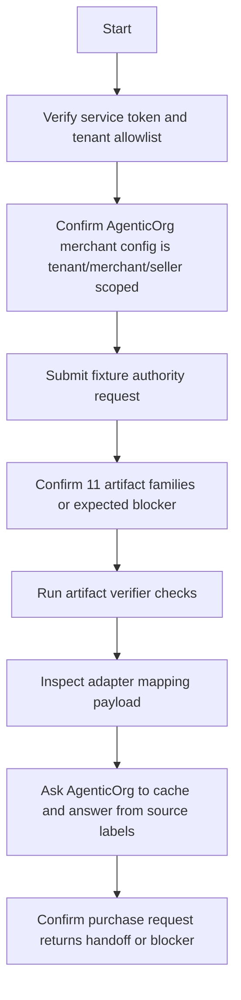

Canonical end-to-end flow: [OACP authority overview](./overview). Launch closure source of truth: [OACP Runtime Launch Closure PRD](./runtime-launch-closure-prd).

## Provision AgenticOrg Authority Access

1. Store `COMMERCE_C6Z_AUTHORITY_SERVICE_TOKEN` through the production secret path.
2. Add the AgenticOrg tenant id to `COMMERCE_C6Z_AUTHORITY_SERVICE_TENANTS`.
3. Deploy or restart the Grantex auth service with both values available.
4. Submit a fixture `POST /v1/commerce/oacp/c6z/authority-requests` for that tenant.
5. Confirm `artifact_count = 11`, or record the exact refusal/blocker.
6. To roll back, remove the tenant id from `COMMERCE_C6Z_AUTHORITY_SERVICE_TENANTS` and rotate the token if there is any suspicion of exposure.

Never put Shopify tokens, provider credentials, payment credentials, raw provider payloads, checkout links, raw POS callbacks, or webhook secrets in Grantex artifacts or logs.

## Smoke Tests

## Checklist

| Check | Command or evidence |
| --- | --- |
| Authority route exists | `apps/auth-service/src/routes/commerce-oacp-runtime.ts` |
| AgenticOrg tenant allowlist | `COMMERCE_C6Z_AUTHORITY_SERVICE_TENANTS` contains only approved tenant ids |
| AgenticOrg service token | `COMMERCE_C6Z_AUTHORITY_SERVICE_TOKEN` is present only via secret manager |
| Artifact tests pass | `npm --prefix apps/auth-service test -- commerce-c6z-runtime-artifact-authority.test.ts` |
| Adapter tests pass | `npm --prefix apps/auth-service test -- commerce-c6w4-oacp-adapter-previews.test.ts` |
| Conformance gate | `node scripts/commerce-c6oe-preview-conformance-gate.mjs --mode pr` |
| Guardrail scan | Search changed docs for stale or overclaim wording. |
| Merchant config boundary | Confirm Shopify is runtime-supported and WooCommerce/ERP/bank/custom provider configs are pending-adapter unless approved. |

## Rollback

1. Remove the AgenticOrg tenant from `COMMERCE_C6Z_AUTHORITY_SERVICE_TENANTS`.
2. Rotate the service token if compromise is suspected.
3. Ask AgenticOrg to stop refreshing artifacts and mark affected cache records stale.
4. Leave existing historical artifacts reviewable for audit/export.
5. Publish an operator note with affected tenants, merchant ids, artifact families, and timestamps.

## Arbiter Decision Ledger

`POST /v1/commerce/oacp/arbiter-decisions` records every AgenticOrg arbiter decision in `commerce_arbiter_decisions` (migration `134_commerce_ledger.sql`), append-only: a trigger refuses `UPDATE`, `DELETE` and `TRUNCATE`, and a check constraint refuses a refusal row that carries a grant. It needs no new configuration: the service token and `COMMERCE_C6Z_AUTHORITY_SERVICE_TENANTS` already provisioned for authority requests apply.

| Check | Evidence |
| --- | --- |
| An `allow` is countersigned | `201` with `decision_grant`; the token verifies against `/.well-known/jwks.json` and carries `approver_auth: "policy_arbiter"` |
| A `refuse` mints nothing | `201 {recorded: true}`; the row has `grant_jti IS NULL` |
| Replays are idempotent | the same body answers `200` with the same `jti`; another body answers `409 arbiter_decision_conflict` |
| Human approvals stay human | a `policy_arbiter` grant presented to `POST /v1/decisions/consume` is refused `400 malformed` |
| Tests | `npm --prefix apps/auth-service test -- commerce-oacp-arbiter-decisions.test.ts` |

To stop countersigning for a tenant, remove it from `COMMERCE_C6Z_AUTHORITY_SERVICE_TENANTS`; recorded decisions stay readable for audit.

## Witness Checkpoints

`POST /v1/audit/witness-checkpoints` stores AgenticOrg audit chain heads in `audit_witness_checkpoints` and refused forks in `audit_witness_forks` (both append-only, migration `134_commerce_ledger.sql`). It is authenticated with the AgenticOrg service token alone; no tenant allowlist applies, because `tenant_ref` names AgenticOrg's own tenant.

A row in `audit_witness_forks` means AgenticOrg presented a second, different hash for a chain position Grantex had already witnessed: treat it as an irregularity, open an incident with AgenticOrg, and keep both the witnessed countersignature and the fork record for the review. Read them with `GET /v1/audit/witness-checkpoints?source=agenticorg&tenant_ref=...`.

| Check | Evidence |
| --- | --- |
| Countersignature verifies | header `typ` `audit-witness+jwt`, `kid` in `/.well-known/jwks.json` |
| Replay is idempotent | the same head answers `200` with the same `witness_id` |
| Fork is refused | another hash at a witnessed `head_seq` answers `409 WITNESS_FORK` and adds a fork row |
| Tests | `npm --prefix apps/auth-service test -- audit-witness-checkpoints.test.ts` |

## Wallet Ledger Chain

Migration `134_commerce_ledger.sql` adds `chain_seq`, `prev_hash` and `entry_hash` to `wallet_ledger_entries`, chains every new entry in a `BEFORE INSERT` trigger under a per-wallet advisory lock, and backfills existing entries per wallet in `(created_at, id)` order. The backfill disables the table's append-only trigger only inside the migration transaction, which already holds an exclusive lock on the table; it is enabled again before commit. Plan the migration for a maintenance window on a large ledger. No flag: the columns and trigger are additive and no existing response changes.

| Check | Evidence |
| --- | --- |
| A wallet's chain is intact | `GET /v1/admin/prepaid-wallets/{walletId}/ledger/verification` with the admin credential answers `valid: true` |
| Tampering is found | `valid: false` lists each `entry_hash_mismatch` (edited), `prev_hash_mismatch` / `chain_seq_mismatch` (deleted, inserted or reordered) entry |
| Tests | `npm --prefix apps/auth-service test -- wallet-ledger-chain.test.ts` and, with `AUDIT_INTEGRATION_DATABASE_URL`, `commerce-ledger-postgres.integration.test.ts` |

A failed verification is an irregularity in financial evidence: block the wallet, keep a database snapshot, and reconcile from backups before any repair. Never repair a ledger by editing or deleting entries.

## Refusal Copy

Use exact blockers: missing source evidence, stale artifact, unsafe executable request, provider capability missing, tenant not allowlisted, or authority temporarily unavailable.

## Ownership

Grantex is owned by Orchestrum Technologies LLP. Inventor and owner: Sanjeev Kumar. Ownership contact: [sanjeev@orchestrum.in](mailto:sanjeev@orchestrum.in) or [mishra.sanjeev@gmail.com](mailto:mishra.sanjeev@gmail.com).
