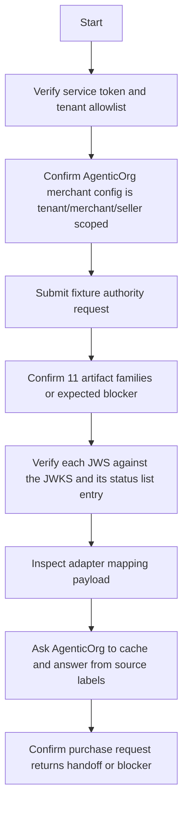

Canonical end-to-end flow: [OACP authority overview](./overview). Launch closure source of truth: [OACP Runtime Launch Closure PRD](./runtime-launch-closure-prd).

## Provision AgenticOrg Authority Access

1. Store `COMMERCE_C6Z_AUTHORITY_SERVICE_TOKEN` through the production secret path.
2. Add the AgenticOrg tenant id to `COMMERCE_C6Z_AUTHORITY_SERVICE_TENANTS`.
3. Deploy or restart the Grantex auth service with both values available. `PUBLIC_BASE_URL` must be
   https (status list URIs are built from it).
4. Create the first OACP issuer key: `POST /v1/commerce/oacp/issuer-keys/rotate` with the platform
   admin key. Confirm its `kid` (`oacp-...`) appears in `GET /.well-known/jwks.json`.
5. Set `OACP_STATUS_LIST_PUBLIC_ENABLED=true` and restart when relying parties are ready to check
   status; until then they refuse artifacts with `revocation_status_unavailable`.
6. Submit a fixture `POST /v1/commerce/oacp/c6z/authority-requests` for that tenant.
7. Confirm `artifact_count = 11`, or record the exact refusal/blocker.
8. To roll back, remove the tenant id from `COMMERCE_C6Z_AUTHORITY_SERVICE_TENANTS` and rotate the token if there is any suspicion of exposure.

For a local stack (`PUBLIC_BASE_URL=http://localhost:<port>`), also set
`OACP_ALLOW_LOOPBACK_HTTP=true`; without it issuance refuses the http status list URI. It is
ignored when `NODE_ENV` is production. Then run the live conformance suite:
`GRANTEX_CONFORMANCE_INTERNAL_TOKEN=<service token> grantex-conformance --base-url http://localhost:<port> --api-key <developer key> --include oacp --suite oacp --oacp-issuer http://localhost:<port> --oacp-tenant <tenant>`.

Never put Shopify tokens, provider credentials, payment credentials, raw provider payloads, checkout links, raw POS callbacks, or webhook secrets in Grantex artifacts or logs.

## Keys and Revocation

| Task | Action |
| --- | --- |
| Rotate the issuer key (scheduled or after an incident) | `POST /v1/commerce/oacp/issuer-keys/rotate` (platform admin). The previous key retires and stays in the JWKS until its artifacts expire. |
| Key compromise | `POST /v1/commerce/oacp/issuer-keys/:kid/revoke`, then rotate. Every artifact the key signed stops verifying at once; ask AgenticOrg to refresh. |
| List keys | `GET /v1/commerce/oacp/issuer-keys` (no private material). |
| Revoke one artifact | `POST /v1/commerce/oacp/artifacts/:artifactId/revoke` with `{"reason_code": "..."}`. The status list shows INVALID within its 30 s ttl and a `revocation` artifact is issued. Revocation is final. |
| Audit what was issued or refused | `GET /v1/commerce/oacp/artifacts?tenant_id=...` or the `oacp_artifacts` table. |

## Smoke Tests

## Checklist

| Check | Command or evidence |
| --- | --- |
| Authority route exists | `apps/auth-service/src/routes/commerce-oacp-runtime.ts` |
| AgenticOrg tenant allowlist | `COMMERCE_C6Z_AUTHORITY_SERVICE_TENANTS` contains only approved tenant ids |
| AgenticOrg service token | `COMMERCE_C6Z_AUTHORITY_SERVICE_TOKEN` is present only via secret manager |
| Artifact tests pass | `npm --prefix apps/auth-service test -- commerce-c6z-runtime-artifact-authority.test.ts` |
| Signature tests pass | `npm --prefix apps/auth-service test -- oacp-jws-vectors.test.ts commerce-c6w2-oacp-artifact-authority.test.ts` |
| Persistence, replay, revocation, keys | `AUDIT_INTEGRATION_DATABASE_URL=... npm --prefix apps/auth-service test -- commerce-oacp-artifacts-postgres.integration.test.ts` |
| JWKS carries the OACP key | `GET /.well-known/jwks.json` contains one `kid` starting `oacp-` with `alg` `ES256` |
| Conformance gate | `node scripts/commerce-c6oe-preview-conformance-gate.mjs --mode pr` |
| Guardrail scan | Search changed docs for stale or overclaim wording. |
| Merchant config boundary | Confirm Shopify is runtime-supported and WooCommerce/ERP/bank/custom provider configs are pending-adapter unless approved. |

## Rollback

1. Remove the AgenticOrg tenant from `COMMERCE_C6Z_AUTHORITY_SERVICE_TENANTS`.
2. Rotate the service token if compromise is suspected.
3. Ask AgenticOrg to stop refreshing artifacts and mark affected cache records stale.
4. Leave existing historical artifacts reviewable for audit/export (`oacp_artifacts`).
5. To invalidate artifacts already handed out, revoke them individually, or revoke the issuer key
   to invalidate everything it signed.
6. Publish an operator note with affected tenants, merchant ids, artifact families, and timestamps.

## Refusal Copy

Use exact blockers: missing source evidence, stale artifact, unsafe executable request, provider capability missing, tenant not allowlisted, or authority temporarily unavailable.

## Ownership

Grantex is owned by Orchestrum Technologies LLP. Inventor and owner: Sanjeev Kumar. Ownership contact: [sanjeev@orchestrum.in](mailto:sanjeev@orchestrum.in) or [mishra.sanjeev@gmail.com](mailto:mishra.sanjeev@gmail.com).
