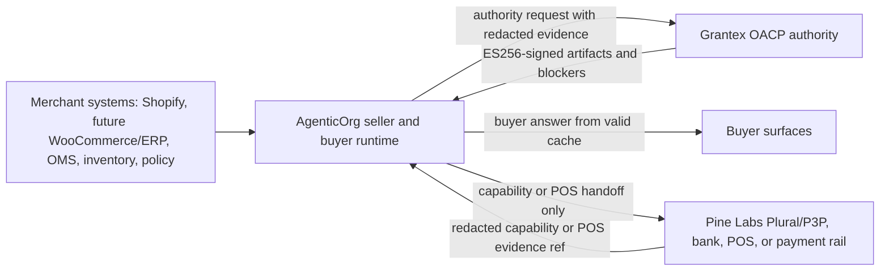

This is the canonical Grantex OACP page. The canonical end-to-end flow starts here and links to the AgenticOrg runtime guide from the integration page. Launch closure source of truth: [OACP Runtime Launch Closure PRD](./runtime-launch-closure-prd).

OACP is the trust and interoperability layer for agentic commerce. Grantex owns the protocol, trust, policy, artifact, verification, and protocol-adapter authority. AgenticOrg owns the buyer and seller AI-agent runtime, merchant self-service configuration, Shopify connector runtime, future connector setup intent, buyer sessions, channel bridges, OACP cache, and provider-owned mandate capability verification.

Merchant systems such as Shopify, future WooCommerce/ERP sources, and POS systems remain the source of record. Pine Labs Plural/P3P, bank-owned rails, POS systems, and other provider rails own mandate, payment, and in-store execution. Grantex must not become a toll booth for every buyer and seller interaction.

## Four-Party Architecture

## What Grantex Owns

| Area | Grantex role |
| --- | --- |
| Trust authority | Issues or refuses signed OACP artifacts, persists every issue and refusal, and revokes or suspends artifacts on the OACP Token Status List. |
| Mandates | Issues Intent, Cart and Payment mandates (ES256 JWTs, claims mapped to AP2 v0.2 member names) within the Commerce Passport cap and an active consent ([mandates decision](./mandates-decision)). |
| Decision and ledger evidence | Records and countersigns AgenticOrg's arbiter decisions (machine-profile decision grants) and witnesses AgenticOrg audit chain heads. It does not make the decision. |
| Policy governance | Defines artifact TTL, freshness, source, revocation, risk, and blocked-capability rules. |
| Artifact verification | Verifies the ES256 detached JWS against `/.well-known/jwks.json`, the payload hash, TTL, scope, public-safe payload constraints and the OACP Token Status List ([artifact authority](./artifact-authority)). |
| Protocol adapters | Governs compatibility mappings from canonical OACP artifacts to Schema.org, UCP (business profile at 2026-04-08 / 2026-08-25), ACP (order events, delegate-payment allowance), AP2 (the mandates above), A2A, MCP, and OpenAPI payloads. |
| Integration boundary | Accepts allowlisted AgenticOrg authority requests with public-safe connector evidence. |

## What Grantex Does Not Own

Grantex does not own Shopify runtime credentials, WooCommerce/ERP connector credentials, merchant onboarding UX, buyer sessions, WhatsApp or Telegram webhooks, MCP/OpenAPI client sessions, AgenticOrg artifact cache storage, Offline POS Bridge orchestration, final checkout execution, POS transaction execution, order creation, stock holds, provider-side mandate registration (for example a UPI AutoPay mandate), payment capture, refund execution, or provider/bank settlement.

## Runtime Reality

| Status | Reality |
| --- | --- |
| Implemented runtime (merged and deployed) | `POST /v1/commerce/oacp/c6z/authority-requests` with ES256-signed, persisted, replayable and revocable artifacts; the artifact verifier; mandates; arbiter decisions and witness checkpoints; the UCP profile, ACP allowance and order events; settlement-receipt commitment evidence; and OACP guard tests. The unmounted C6W4-C6W9 and C6X2 helpers were deleted ([decision](./library-helper-decision)). Status by date: [launch closure PRD](./runtime-launch-closure-prd). |
| Implemented docs only | Historical Commerce V1 planning and C6 audit/review reports remain useful as internal history but are superseded for the public OACP split. |
| Requires operator action, credentials or approval | The first OACP issuer key in each environment, `OACP_STATUS_LIST_PUBLIC_ENABLED` (off by default; relying parties refuse until it is on), the AgenticOrg service token and tenant allowlist, merchant Shopify access, channel approvals, and provider rail approval. |
| Missing | Public standards program approval, universal channel launch, live POS provider approval, non-Shopify source adapters, bank/custom payment adapters, broad payment/order execution, AP2 v0.2 SD-JWT VC mandates, and published SDK releases with the OACP verifiers. |
| Stale/confusing documentation | Older Commerce V1 pages that frame Grantex as the merchant control plane are historical; use this OACP group for the current authority narrative. |

## Artifact Families

Grantex issues or refuses these OACP families for the C6Z AgenticOrg runtime path: `merchant_profile`, `seller_agent_card`, `connector_evidence`, `catalog_snapshot`, `offer_price_snapshot`, `inventory_snapshot`, `policy_scope`, `public_discovery_state`, `mandate_capability`, `protocol_adapter`, and `authority_request_status`. The revoke route issues `revocation` artifacts and the settlement-receipt route issues `commitment_evidence` artifacts; both are signed and on the status list like the others.

## Buyer-Safe Rule

AgenticOrg may continue non-binding product questions and comparison from valid cached artifacts. A request that would commit the buyer, create a checkout, create a mandate, capture payment, execute a POS transaction, reserve inventory, create an order, refund, return, or ship must use the approved provider, merchant, POS, and channel path. For a purchase, Grantex issues the mandates and countersigns the arbiter's decision; the provider executes the payment. OACP artifacts do not invent success.

## Related Pages

- [Architecture](./architecture)
- [Runtime launch closure PRD](./runtime-launch-closure-prd)
- [Merchant self-service config](./merchant-self-service-config)
- [Artifact authority](./artifact-authority)
- [Offline POS Bridge boundary](./pos-bridge-boundary)
- [AgenticOrg integration guide](./agenticorg-integration)
- [Mandates decision](./mandates-decision)
- [Agent network identity](./agent-network-identity)
- [Operator runbook](./operator-runbook)
- [Launch readiness](./launch-readiness)

## Ownership

Grantex is owned by Orchestrum Technologies LLP. Inventor and owner: Sanjeev Kumar. Ownership contact: [sanjeev@orchestrum.in](mailto:sanjeev@orchestrum.in) or [mishra.sanjeev@gmail.com](mailto:mishra.sanjeev@gmail.com).
