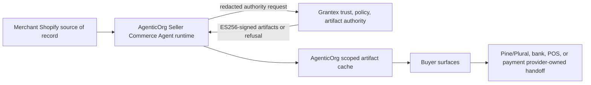

# OACP Runtime Launch Closure PRD

Status date: 2026-10-20

This is the canonical Grantex closure PRD for the OACP Shopify merchant runtime. Older Commerce V1 C6/C6W/C6X/C6Y documents are historical/internal compatibility records and are superseded for launch decisions by this OACP guide set.

## Status On 2026-10-20

### Merged to `main` and deployed

The OACP closure work landed in six pull requests on 2026-10-20 (#1790 Phase 1, #1791, #1792 Phase 2, #1793 Phase 3, #1794 Phase 4, #1795 Phase 5). A merge to `main` deploys the auth service; `main` at `b9ef3f14` is deployed. What that code does:

| Area | What is on `main` |
| --- | --- |
| Artifact integrity (G1-G4, G7) | ES256 detached JWS over the RFC 8785 envelope, DB-backed `oacp-` issuer keys in `/.well-known/jwks.json`, every issue and refusal persisted, replay, read, revoke, suspend and reinstate routes, a Token Status List entry on every artifact and a signed `revocation` artifact on revoke. The template signer and the unmounted C6W4-C6X2 helpers are deleted. See [artifact authority](./artifact-authority). |
| SDK verifiers and conformance (G6, G8) | `verifyOacpArtifact` and `verifyOacpMandate` in the TypeScript, Python and Go SDK sources, and the `oacp` conformance suite. These are source additions, not yet in a published package release. |
| Ledger (G16) | Arbiter decision ledger with machine-profile decision grants, audit witness checkpoints with `WITNESS_FORK`, and a hash chain on `wallet_ledger_entries`. |
| Protocol surfaces (G17, G18, G24, G35-G37) | UCP business profile from issued artifacts, merchant opt-in to public discovery, ACP delegate-payment allowance and order events, UCP identity-linking and Grantex ACP scopes in `@grantex/mcp-auth`. The UCP-style, ACP-style and AP2-style preview routes are removed. |
| Mandates (G41-G46) | Intent, Cart and Payment mandates as ES256 JWTs mapped to AP2 v0.2 member names, presence and `amr` on consent and passport, passkey-anchored human-present carts, provider capability evidence bound into `mandate_capability`, status-list revocation (cascading) and suspension. See [mandates decision](./mandates-decision). |
| Network identity and receipts (G49-G54, G59, G60) | Profile-driven RFC 9421 signing for the Grantex, Visa TAP and Web Bot Auth profiles, the registry key directory, scheme agent ids, the KYA tier claim and x402 / MPP settlement receipts as `commitment_evidence` artifacts. See [agent network identity](./agent-network-identity). |

### Not yet turned on in production

Deployed code is not the same as a live path. On 2026-10-20:

- The production JWKS (`https://api.grantex.dev/.well-known/jwks.json`) lists no `oacp-` key. Until an operator creates one, every artifact and mandate issuance in production answers `503 oacp_issuer_key_unavailable`.
- `OACP_STATUS_LIST_PUBLIC_ENABLED` is off: `GET /status/oacp/:list` is not served (it answers `401`). Relying parties, including AgenticOrg, therefore refuse every artifact and mandate with `revocation_status_unavailable`.
- `OACP_PUBLIC_DISCOVERY_ISSUANCE_ENABLED`, `HTTP_SIGNATURE_DIRECTORY_ENABLED`, `REGISTRY_SCHEME_AGENT_IDS_ENABLED` and `AGENT_PASSPORT_KYA_TIER_ENABLED` are at their default, off.
- AgenticOrg verifies Grantex artifacts before caching them (merged in AgenticOrg). Its arbiter and ledger, UCP / ACP surfaces, mandate client, payment executor and request-signing work are still in review in AgenticOrg, each behind its own flag that defaults off.

The turn-on order is in the [operator runbook](./operator-runbook#production-turn-on-order): first OACP issuer key, then `OACP_STATUS_LIST_PUBLIC_ENABLED`, then AgenticOrg.

## Corrected Architecture



Grantex owns trust, protocol, policy, canonical OACP artifacts, mandates, verification, adapter governance, and the AgenticOrg service-token/tenant allowlist. AgenticOrg owns runtime, connectors, buyer surfaces, artifact cache, public catalog pages, buyer conversations, the purchase decision (its policy arbiter) and provider-owned handoff orchestration. Merchant systems remain source of record. Pine Labs Plural/P3P, POS, bank, and payment providers own execution.

Grantex must not become a toll booth for every buyer/seller interaction. AgenticOrg may answer non-binding buyer questions from valid cached artifacts and must refresh or refuse commitment-bound flows when artifacts, provider evidence, or merchant source state are stale. A purchase does call Grantex: for its mandates and for the countersignature of the arbiter's decision.

## Canonical Authority Route

`POST /v1/commerce/oacp/c6z/authority-requests`

Accepts:

- allowlisted AgenticOrg service token, or an operator of the same commerce tenant;
- tenant, merchant, seller agent scope;
- Shopify read-only connector evidence refs and counts;
- source observed timestamp and bounded freshness policy;
- requested 11 OACP artifact families;
- non-enablement flags, or the public discovery opt-in (`public_discovery_requested`, `namespace_attestation_ref`, `serving_host`);
- optional `mandate_capability_evidence` from the provider capability verifier.

Rejects or blocks:

- missing tenant/service-token allowlist;
- invalid token;
- stale evidence;
- raw Shopify/provider/POS payloads;
- secrets, credentials, checkout links, payment links, or raw provider callbacks;
- execution targets or certification/standardization claims.

Returns:

- `201 artifact_issuance_ready` with 11 ES256-signed artifact families;
- `202 received` when connector evidence is not yet attached;
- `403 service_tenant_not_allowed` for non-allowlisted service tenant;
- `422` for unsafe, stale, malformed, or executable requests (recorded, with `refusal_record_id`);
- `503 oacp_issuer_key_unavailable` when no OACP issuer key is active.

## Artifact Metadata Closure

Every issued artifact must carry:

- source lineage;
- TTL seconds;
- freshness status and stale behavior;
- revocation posture;
- blocked and unsupported capabilities;
- non-sensitive evidence refs only;
- an ES256 detached JWS signature (`oacp-artifact+jws`) and a Token Status List entry;
- no raw Shopify payloads;
- no raw provider payloads;
- no payment credentials;
- no connector secrets;
- no live checkout/payment/order/POS success claim.

The C6Z authority implementation lives in:

- `apps/auth-service/src/lib/commerce/oacp-runtime-vertical.ts`
- `apps/auth-service/src/routes/commerce-oacp-runtime.ts`
- `apps/auth-service/tests/commerce-c6z-runtime-artifact-authority.test.ts`

## Operator Provisioning

The full steps, including the production turn-on order, are in the [operator runbook](./operator-runbook). In short:

1. Create or rotate `COMMERCE_C6Z_AUTHORITY_SERVICE_TOKEN` through the production secret path.
2. Add the AgenticOrg tenant id to `COMMERCE_C6Z_AUTHORITY_SERVICE_TENANTS`.
3. Restart or redeploy the Grantex auth service with the updated secret and allowlist.
4. Create the first OACP issuer key (`POST /v1/commerce/oacp/issuer-keys/rotate`).
5. Turn on `OACP_STATUS_LIST_PUBLIC_ENABLED`.
6. Run a fixture authority request for that tenant and confirm `artifact_count = 11`, or record the exact blocker.
7. Remove the tenant from the allowlist to roll back.

Example local smoke:

```bash
npm --prefix apps/auth-service test -- commerce-c6z-runtime-artifact-authority.test.ts
node scripts/commerce-oacp-runtime-launch-check.mjs
```

## Closure Checklist

| Requirement | Grantex closure path | Status |
| --- | --- | --- |
| Canonical route documented | This PRD, OpenAPI, operator runbook, integration docs. | Implemented |
| Tenant allowlist docs | This PRD and operator runbook. | Implemented |
| Missing tenant/token tests | `commerce-c6z-runtime-artifact-authority.test.ts`. | Implemented |
| Unsafe evidence tests | Raw payload, secret, and execution-target rejection. | Implemented |
| Stale evidence tests | `source_evidence_stale` and connector stale checks. | Implemented |
| Valid issuance tests | 11 artifact-family issuance, each verified. | Implemented |
| Artifact metadata | Source lineage, TTL, freshness, revocation, evidence refs, ES256 detached JWS, status list entry, persistence. | Implemented |
| Verifier | Eight-step verification in the auth service and in the TypeScript, Python and Go SDK sources, against shared vectors. | Implemented (SDK releases pending) |
| No raw private payloads | Payload guard and tests. | Implemented |
| No transaction toll booth | Docs and architecture. | Implemented |
| Production issuer key | `POST /v1/commerce/oacp/issuer-keys/rotate` in production. | Not done (operator step) |
| Public status list | `OACP_STATUS_LIST_PUBLIC_ENABLED=true` in production. | Not done (operator step, owner approval) |
| AgenticOrg runtime | Verify-before-cache merged; arbiter, ledger, surfaces, mandates and executor in review. | Partial |

## Validation Commands

```bash
npm --prefix apps/auth-service test -- commerce-c6z-runtime-artifact-authority.test.ts oacp-jws-vectors.test.ts oacp-mandate-vectors.test.ts commerce-ucp-profile.test.ts commerce-no-plural-leak.test.ts commerce-openapi.test.ts
npm --prefix apps/auth-service run typecheck
node scripts/commerce-c6oe-preview-conformance-gate.mjs --mode pr
git diff --check origin/main...HEAD
```

With a disposable Postgres (`AUDIT_INTEGRATION_DATABASE_URL`), also run `commerce-oacp-artifacts-postgres.integration.test.ts` and `commerce-oacp-mandates-postgres.integration.test.ts`.

## Launch Readiness Rule

Grantex is launch-ready for this vertical only when the production issuer key exists, the public status list is on, AgenticOrg has a real Shopify merchant/dev-store evidence run, and Grantex returns either valid 11-family artifacts that AgenticOrg verifies or an exact refusal through the canonical authority route, with no raw secrets or raw private payloads stored or logged. Public standards approval, ChatGPT/Gemini listing approval, WhatsApp/Telegram approval, Pine/Plural provider approval, and POS provider approval remain external blockers unless separately proven.

## Ownership

Grantex is owned by Orchestrum Technologies LLP. Inventor and owner: Sanjeev Kumar. Ownership contact: [sanjeev@orchestrum.in](mailto:sanjeev@orchestrum.in) or [mishra.sanjeev@gmail.com](mailto:mishra.sanjeev@gmail.com).
